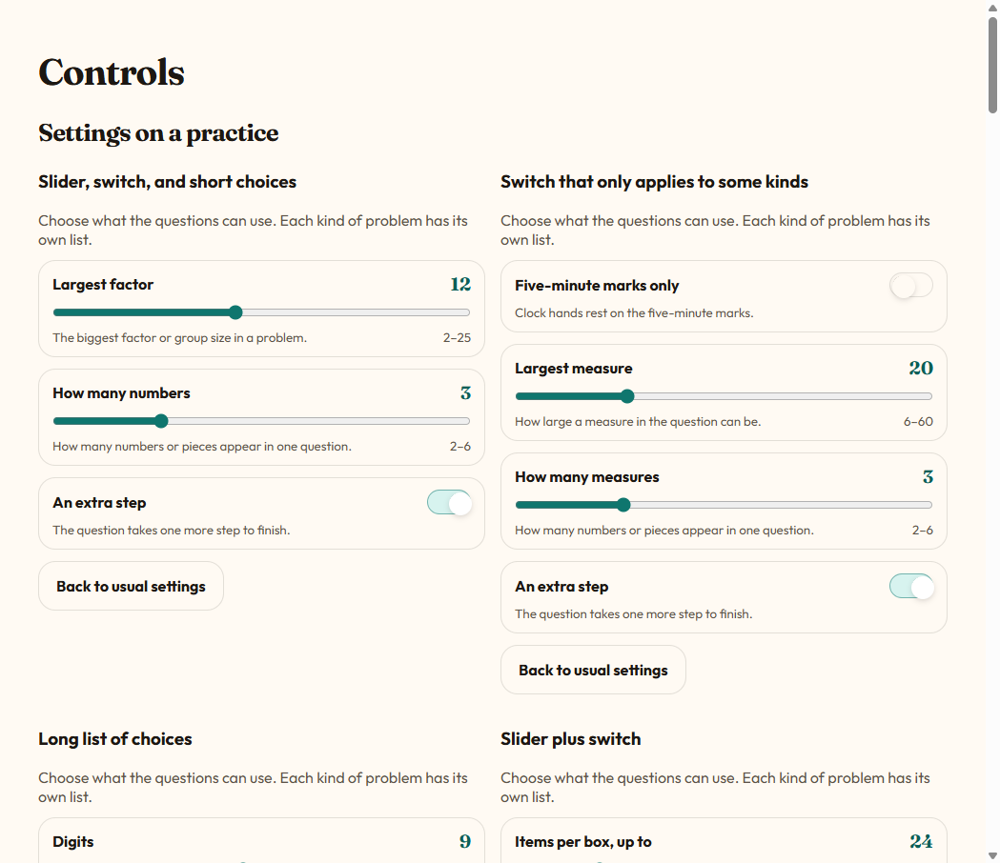
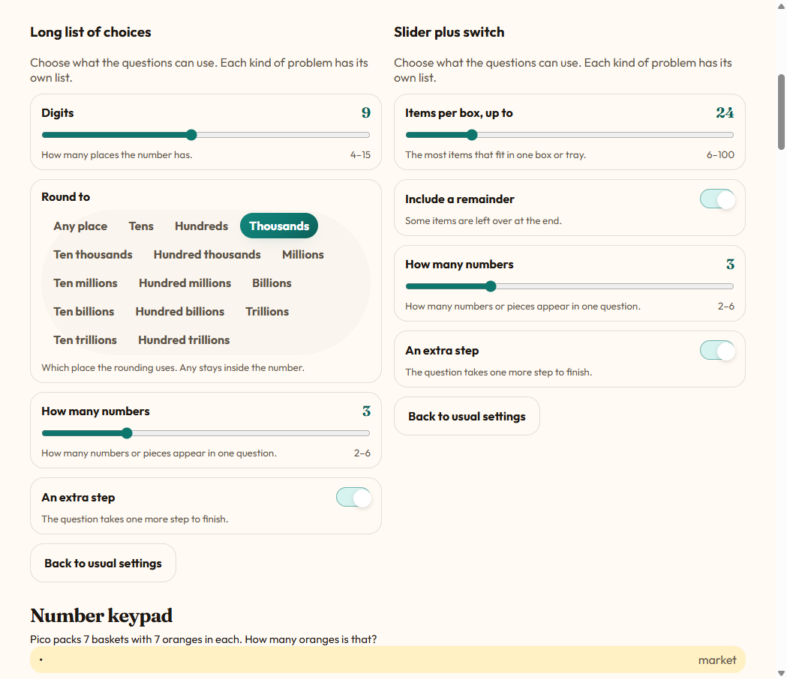
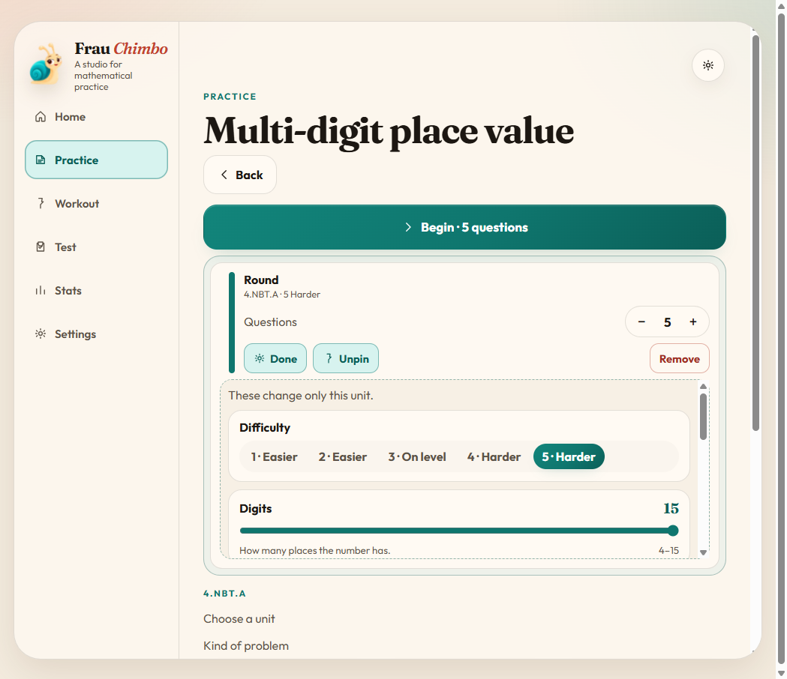
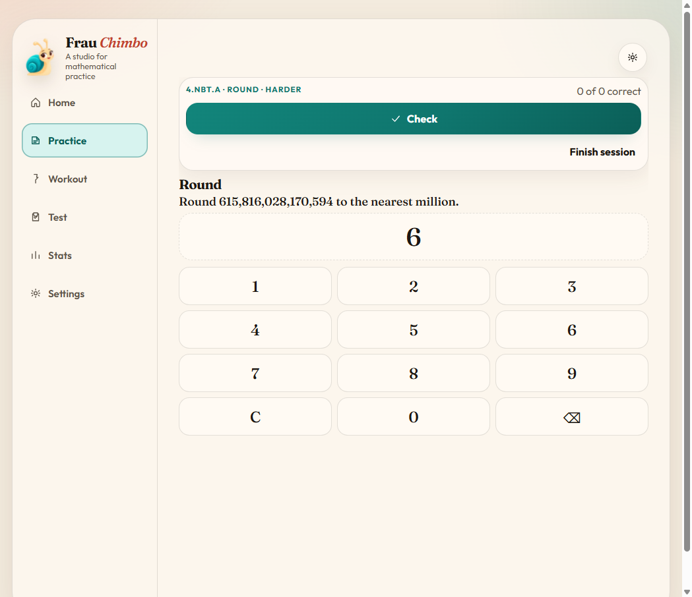
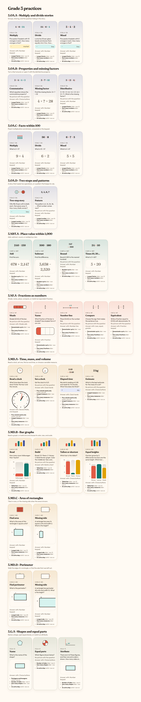
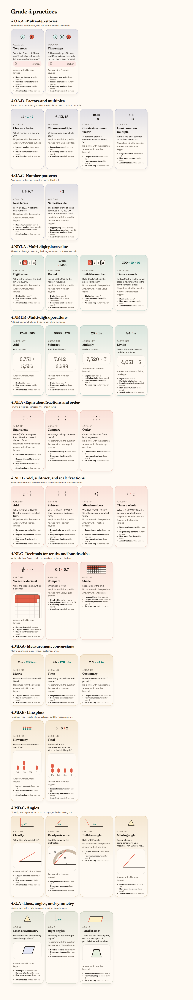
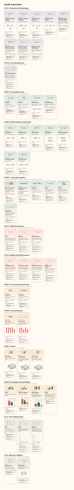
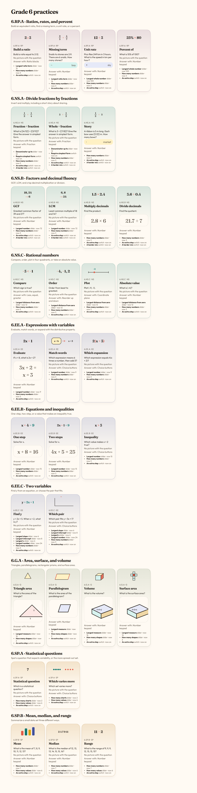
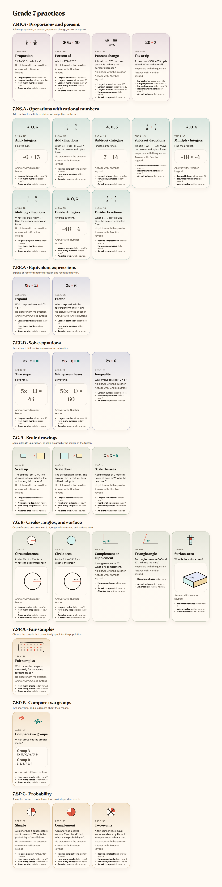

# Practice review

I looked at all **184 practices** across the **55 skills** in grades 3–7. Each screenshot below is one grade, with every practice in that grade: the card picture, a sample question, the answer control, and the settings that practice shows. The written list under the pictures is the same set, with the range of each variable.

Nothing in the practices was changed.

The usual level in the lists is level 3, the one labeled “On level.” The five numbers or on/off states after that are levels 1 through 5.

## Visuals

The card pictures are the strongest part of the system. They share one drawing style: coral, teal, gold, and a paper card. An operation is readable at a glance (`4 × 6 = 24` against `24 ÷ 6 = 4`), and the better pictures are the ones that are objects rather than sentences: clocks, fraction bars, bar charts, grids, rectangles with a missing side, place-value boxes, and the small scale-up / scale-down pair.

The question underneath the card is often thinner than the card. Four questions were drawn for each practice, and every practice stayed on one kind of picture. **102** have no figure in the stem. **29** show the expression itself, which is enough for `2,760 + 1,805` and for `3x + 2`. **10** story practices show a tinted strip whose only picture is a mark and the word `market`, `bay`, `sky`, or `kitchen`. Ten of the empty stems put the figure in the answer control on purpose: shade the bar, set the clock, build the chart, drag the angle, tap the number line, or plot the point. The other **43** practices draw a real object: a clock, chart, rectangle, shape, prism, grid, dots, angle, circle, balance, or coordinate plane.

Three skills have only one kind of problem, so they never get their own unit picture and fall back to the skill drawing: **5.OA.B Two related patterns**, **7.SP.A Fair samples**, and **7.SP.B Compare two groups**.

A few card pictures repeat a shape that the title has to distinguish. Area and perimeter both use a rectangle with a question mark for the missing side. Classify-an-angle and lines-of-symmetry both lean on a 90° mark. Surface area in grade 6 and grade 7 both use the same net.

## Variables

The specific settings are the good ones, and they are aimed at the skill:

- Size that the question really uses: largest factor, numbers up to, digits, denominator, tallest bar, longest side, decimal places, price, percent, radius, scale factor, distance from zero.
- A real switch: five-minute clock marks, include a remainder, require simplest form, hundredths, numbers in words, all shapes.
- A real choice: round-to place, expression shape, integers or fractions.

Across the 184 practices, the generators **read 251** of the visible settings. **366** are fillers the app adds so every practice has several knobs. Most of them are “How many numbers” (or fractions, measures, shapes, values), “An extra step,” and “A harder mix.” A smaller set is “Largest number,” “Number of sides,” or “How many charts,” on skills where that name is only a size nudge. The label says the question will contain more numbers, or take another step. What changes is how big a number is allowed to get.

They also show up on every kind of question in the skill. The five-minute switch correctly hides itself on the estimate question. “How many measures” and “An extra step” stay on the clock questions, where the estimate branch is the one that reads them.

One setting is unused. On **3.G.A Name**, the switch **Pentagons and hexagons** is on at the usual level and the generator never reads it. **Number of sides** is the slider that actually brings in a pentagon or a hexagon.

**Require simplest form** and **Round to** are read, through a shared fraction helper and a shared rounding helper. On **4.NF.A Equivalent**, the simplest-form switch appends “Give the answer in simplest form” onto a prompt that already says “in simplest form,” so the sentence appears twice.

## Controls

I used these on a live practice: grade filter and strand, adding **4.NBT.A Round**, Adjust, difficulty, the question stepper, Pin, and the number keypad inside a real round question. I also opened every other answer control on a page of live questions.

### Setting a practice

| Control | What I did | How it feels |
| --- | --- | --- |
| Slider | Moved the level to 5 and watched Digits go from 9 to 15 | Easy. The name, the big current number, the hint, and the range (`4–15`) are all in one row. Dragging the track is the whole interaction. |
| Switch | Turned on “Five-minute marks only” with one click. “Include a remainder” is the same control | Easy. Teal and a knob to the right means on. The hint sits under the name. |
| Round to | Opened the 15 places, from Any place through Hundred trillions. This is the only choice list in the settings. The kind of problem is the practice card | Each pill is clear, and the selected one (Thousands) is teal. The names rhyme (`Ten millions`, `Ten billions`, `Ten trillions`), so scanning is slow. The list also sits inside a panel capped at 240px, so on the practice screen you scroll inside the card to reach the later places. |
| Difficulty | Chose **5 · Harder** | The click is easy, and it rewrote the other settings to that level’s presets, which is the right surprise. Levels 1 and 2 are both labeled “Easier,” and 4 and 5 are both labeled “Harder.” The number is the only difference. |
| Question count | Pressed + and the row went from 4 to 5, and Begin followed | Easy. Minus, the count, plus. It stops at 1. |
| Adjust / Pin / Remove | Adjust opened the panel and renamed itself Done. Pin became Unpin and turned teal. Remove stays red at the end | Easy to tell apart. Begin stays a full-width button above the row, so starting is the obvious next step. |
| Back to usual settings | Present under every variable list | The label is clear. On a long list it sits at the bottom of that short scrolling panel, so it is easy to miss until you scroll. |

A few hints do not match the label above them. “How many measures” and “How many numbers” both say “How many numbers or pieces appear in one question.” On a rounding practice, that hint is about a different idea than digits or place.

### Answering a question

| Control | Practices that use it | How it feels |
| --- | --- | --- |
| Number keypad | 104 | The easiest answer. Big keys, the number appears above them, C clears, backspace deletes. I typed 6 on a live round question and it showed up immediately. If the question allows a decimal, the bottom-left key becomes the decimal mark. If it allows negatives, that key becomes ±. Both at once adds a wide ± under the pad. The corner key changes job, which is the one thing to learn. |
| Choice buttons | 30 | One tap, full width. Equations wrap and stay easy to hit. |
| Fraction keypad | 23 | Same pad, after you tap the part you are editing. A line under the pad says “Editing the numerator” (or the denominator, or the whole). That caption is what makes it work. The whole-number box, when it appears, is easy to confuse with the numerator because both are large numerals. |
| Compare | 6 | The two amounts sit on either side of a question mark, then three large buttons: `<`, `=`, `>`. Very easy. |
| Several fields, one keypad | 4 | Used for a clock you read (hour and minute) and for a quotient with a remainder. Tap the field, then type. Same idea as the fraction keypad, and the field name is on the button. |
| Reorder | 3 | Up and down beside each row. Fine for three items, slow for more, and there is no drag. The arrows are only named “up” and “down.” The rows start shuffled. That starting order is submitted immediately, so Check works before a row moves, and that press is wrong. |
| Shade cells | 2 | Tap a cell, the count updates. Easy, and the bar is the picture. |
| Number line | 2 | Tap or drag, it snaps to the step, and the value is written underneath. The line shows the two ends and no ticks between them, so placing 1/2 is a guess about the middle. |
| Clock hands | 2 | Choose Hours or Minutes, then drag the face. The digital time under the clock tells you whether you hit it. The two-mode choice is the awkward part. Minutes are a small target. |
| Build a chart | 2 | The crowded one. Axis pills, size (compact / regular / poster), bars or line, drag a bar, minus and plus, and six colors. The number under each bar and the plus/minus buttons are the easy path. Size and bars-versus-line are not marked. The heights are, the axis has to fit the tallest bar, and the middle bar has to stay teal. It already starts teal. The heights start at 0, and those zeros are submitted immediately, so Check works before a bar is raised. |
| Coordinate plane | 2 | Tap the grid. A crosshair and a readout show the point, and it snaps to whole numbers. A small grid is comfortable. A wide one makes the exact point fiddly. The prompt says to tap. |
| Place-value digits | 2 | Each column is named (millions, thousands, ones) and shows its digit. Typing advances to the next column. At 15 digits the row scrolls sideways. Every column starts at 0, so an untouched column looks like a chosen zero. |
| Angle drag | 1 | Drag the ray. The degree number updates. There is no arc and no tick marks, so 40° is hard to hit by eye. It starts at 0°, and that 0° is submitted immediately, so Check works before the ray moves. |
| Ratio blocks | 1 | Two piles of blocks, each with minus and plus. Very easy to understand. It starts at 1 and 1, and that pair is submitted immediately, so Check works before either side changes. When the two parts of the target are equal, 1:1 is already right. A ratio like 3:10 is a run of taps. |

Check stays the large button. Finish session is a quiet text button, so it is hard to hit by mistake. The header names the practice and the level (`4.NBT.A · Round · Harder`).

## Settings I would add

These are the gaps I would fill with a setting that names a real change. Where a skill already has two honest settings, I would drop the extra sliders whose labels overshoot what they do.

| Skill | Setting I would add | Why |
| --- | --- | --- |
| 3.OA.A, 3.OA.D, 4.OA.A stories | What is unknown: the total, the number of groups, or the size of a group | The stories already hide one of those. A picture of the groups would also replace the `market` / `bay` strip. |
| 3.OA.C Facts | Which tables: 2s, 5s, 10s, or all | Largest factor sets the ceiling. It does not let a student stay on one table. |
| 3.NBT.A, 4.NBT.B | Must regroup | That is the extra step these questions actually have. |
| 3.NF.A | Model: bar, circle, or set | Shade and name are the same fraction idea in different pictures. The denominator slider is already the right size control. |
| 3.MD.A Estimate | What you estimate: mass, liquid, or length | The card is the words `2 kg`, and the question is a list of units. |
| 3.G.A Name | Wire “Pentagons and hexagons” to the shapes, or let Number of sides be the only control | Today the switch is on and unused, while the sides slider does the work. |
| 4.MD.C Angles | Largest degree, and a step of 1° or 5° | “Largest measure” does not say degrees, and the drag control has no ticks to aim at. |
| 4.NF.A Equivalent | Keep simplest form, and stop appending the sentence when the prompt already says it | The switch itself is the right variable. |
| 5.MD.C Volume | Unit cubes shown, or the formula only | The prism picture is there. Whether the cubes are drawn is the interesting choice. |
| 6.RP.A | Model: tape, table, or double number line | Build, missing, unit, and percent are the right kinds. The picture is still mostly the ratio written out. |
| 6.SP.B, 7.SP.B | Include an outlier | “An extra step” is the closest current switch, and it does not mean an outlier. |
| 7.EE.B | Variable on both sides | One-step, two-step, and inequality are covered. Both sides is the next real fork. |
| 7.G.A Scale | Drop “Number of sides” here | Largest scale factor is the setting that matches the pictures. Sides only nudges the random range. |
| 7.G.B Circles | Pi as 3.14 or as 22/7 | Radius is already the right size slider. |
| 7.SP.C Probability | How many equal sectors | The spinner questions use a fixed spinner. “How many charts” does not change it. |

## The practices

The sample question on a card is one draw. The settings under it are the stable part.

---

## Every practice and its variables

“The question uses this” means some question in that skill reads the setting. A clock practice can still list “How many measures,” because the estimate question in the same skill is the one that reads it. “This only changes how large a random number can be” means the label promises a more specific change than the question makes. The sample sentence is one draw at the usual level. `[[3/4]]` in the app is a drawn fraction. Here it is written as `3/4`.

## Grade 3

### 3.OA.A — Multiply and divide stories

Groups, sharing, and the question hiding in the story.

#### Multiply

Sample: Pico packs 7 baskets with 7 oranges in each. How many oranges is that?

Picture: a tinted scene label. Answer control: number keypad.

- **Largest factor** (`max`) — slider 2–25. Usual level: 12. Levels 1–5: 5 / 8 / 12 / 16 / 20. The biggest factor or group size in a problem. The question uses this.
- **How many numbers** (`qty`) — slider 2–6. Usual level: 3. Levels 1–5: 2 / 3 / 3 / 4 / 5. How many numbers or pieces appear in one question. This only changes how large a random number can be.
- **An extra step** (`twist`) — switch. Usual level: on. Levels 1–5: off / off / on / on / on. The question takes one more step to finish. This only changes how large a random number can be.

#### Divide

Sample: Luma has 28 sea-glass beads and shares them equally into 4 tins. How many beads go in each tin?

Picture: a tinted scene label. Answer control: number keypad.

- **Largest factor** (`max`) — slider 2–25. Usual level: 12. Levels 1–5: 5 / 8 / 12 / 16 / 20. The biggest factor or group size in a problem. The question uses this.
- **How many numbers** (`qty`) — slider 2–6. Usual level: 3. Levels 1–5: 2 / 3 / 3 / 4 / 5. How many numbers or pieces appear in one question. This only changes how large a random number can be.
- **An extra step** (`twist`) — switch. Usual level: on. Levels 1–5: off / off / on / on / on. The question takes one more step to finish. This only changes how large a random number can be.

#### Mixed

Sample: Luma has 32 sea-glass beads and shares them equally into 4 tins. How many beads go in each tin?

Picture: a tinted scene label. Answer control: number keypad.

- **Largest factor** (`max`) — slider 2–25. Usual level: 12. Levels 1–5: 5 / 8 / 12 / 16 / 20. The biggest factor or group size in a problem. The question uses this.
- **How many numbers** (`qty`) — slider 2–6. Usual level: 3. Levels 1–5: 2 / 3 / 3 / 4 / 5. How many numbers or pieces appear in one question. This only changes how large a random number can be.
- **An extra step** (`twist`) — switch. Usual level: on. Levels 1–5: off / off / on / on / on. The question takes one more step to finish. This only changes how large a random number can be.

### 3.OA.B — Properties and missing factors

Turn a fact around, or open it with the distributive property.

#### Commutative

Sample: Which equation shows the commutative property?

Picture: no picture. Answer control: choice buttons.

- **Largest factor** (`max`) — slider 3–25. Usual level: 12. Levels 1–5: 6 / 9 / 12 / 16 / 20. The biggest factor or group size in a problem. The question uses this.
- **How many numbers** (`qty`) — slider 2–6. Usual level: 3. Levels 1–5: 2 / 3 / 3 / 4 / 5. How many numbers or pieces appear in one question. This only changes how large a random number can be.
- **An extra step** (`twist`) — switch. Usual level: on. Levels 1–5: off / off / on / on / on. The question takes one more step to finish. This only changes how large a random number can be.

#### Missing factor

Sample: Find the missing factor: 7 × ? = 70

Picture: the expression. Answer control: number keypad.

- **Largest factor** (`max`) — slider 3–25. Usual level: 12. Levels 1–5: 6 / 9 / 12 / 16 / 20. The biggest factor or group size in a problem. The question uses this.
- **How many numbers** (`qty`) — slider 2–6. Usual level: 3. Levels 1–5: 2 / 3 / 3 / 4 / 5. How many numbers or pieces appear in one question. This only changes how large a random number can be.
- **An extra step** (`twist`) — switch. Usual level: on. Levels 1–5: off / off / on / on / on. The question takes one more step to finish. This only changes how large a random number can be.

#### Distributive

Sample: 3 × 3 = 3 × (2 + 1) = (3 × 2) + (3 × ?). What is the missing factor?

Picture: no picture. Answer control: number keypad.

- **Largest factor** (`max`) — slider 3–25. Usual level: 12. Levels 1–5: 6 / 9 / 12 / 16 / 20. The biggest factor or group size in a problem. The question uses this.
- **How many numbers** (`qty`) — slider 2–6. Usual level: 3. Levels 1–5: 2 / 3 / 3 / 4 / 5. How many numbers or pieces appear in one question. This only changes how large a random number can be.
- **An extra step** (`twist`) — switch. Usual level: on. Levels 1–5: off / off / on / on / on. The question takes one more step to finish. This only changes how large a random number can be.

### 3.OA.C — Facts within 100

Fluent multiplication and division, answered on the keypad.

#### Multiply

Sample: What is 9 × 8?

Picture: the expression. Answer control: number keypad.

- **Largest factor** (`max`) — slider 2–25. Usual level: 12. Levels 1–5: 5 / 8 / 12 / 16 / 22. The biggest factor or group size in a problem. The question uses this.
- **How many numbers** (`qty`) — slider 2–6. Usual level: 3. Levels 1–5: 2 / 3 / 3 / 4 / 5. How many numbers or pieces appear in one question. This only changes how large a random number can be.
- **An extra step** (`twist`) — switch. Usual level: on. Levels 1–5: off / off / on / on / on. The question takes one more step to finish. This only changes how large a random number can be.

#### Divide

Sample: What is 35 ÷ 5?

Picture: the expression. Answer control: number keypad.

- **Largest factor** (`max`) — slider 2–25. Usual level: 12. Levels 1–5: 5 / 8 / 12 / 16 / 22. The biggest factor or group size in a problem. The question uses this.
- **How many numbers** (`qty`) — slider 2–6. Usual level: 3. Levels 1–5: 2 / 3 / 3 / 4 / 5. How many numbers or pieces appear in one question. This only changes how large a random number can be.
- **An extra step** (`twist`) — switch. Usual level: on. Levels 1–5: off / off / on / on / on. The question takes one more step to finish. This only changes how large a random number can be.

#### Mixed

Sample: What is 21 ÷ 3?

Picture: the expression. Answer control: number keypad.

- **Largest factor** (`max`) — slider 2–25. Usual level: 12. Levels 1–5: 5 / 8 / 12 / 16 / 22. The biggest factor or group size in a problem. The question uses this.
- **How many numbers** (`qty`) — slider 2–6. Usual level: 3. Levels 1–5: 2 / 3 / 3 / 4 / 5. How many numbers or pieces appear in one question. This only changes how large a random number can be.
- **An extra step** (`twist`) — switch. Usual level: on. Levels 1–5: off / off / on / on / on. The question takes one more step to finish. This only changes how large a random number can be.

### 3.OA.D — Two steps and patterns

A story that needs two operations, or a pattern that keeps its rule.

#### Two-step story

Sample: Otto fills 8 jars with 12 shells each, then gives away 76. How many shells remain?

Picture: a tinted scene label. Answer control: number keypad.

- **Largest number** (`max`) — slider 5–40. Usual level: 16. Levels 1–5: 6 / 10 / 16 / 24 / 32. The biggest group size or count, and the largest pattern step. The question uses this.
- **How many numbers** (`qty`) — slider 2–6. Usual level: 3. Levels 1–5: 2 / 3 / 3 / 4 / 5. How many numbers or pieces appear in one question. This only changes how large a random number can be.
- **An extra step** (`twist`) — switch. Usual level: on. Levels 1–5: off / off / on / on / on. The question takes one more step to finish. This only changes how large a random number can be.

#### Pattern

Sample: The pattern is 5, 18, 31, 44, …. What number comes next?

Picture: no picture. Answer control: number keypad.

- **Largest number** (`max`) — slider 5–40. Usual level: 16. Levels 1–5: 6 / 10 / 16 / 24 / 32. The biggest group size or count, and the largest pattern step. The question uses this.
- **How many numbers** (`qty`) — slider 2–6. Usual level: 3. Levels 1–5: 2 / 3 / 3 / 4 / 5. How many numbers or pieces appear in one question. This only changes how large a random number can be.
- **An extra step** (`twist`) — switch. Usual level: on. Levels 1–5: off / off / on / on / on. The question takes one more step to finish. This only changes how large a random number can be.

### 3.NBT.A — Place value within 1,000

Add, subtract, round, or multiply by a ten.

#### Add

Sample: Find the sum.

Picture: the expression. Answer control: number keypad.

- **Numbers up to** (`within`) — slider 100–100000, step 100. Usual level: 5000. Levels 1–5: 300 / 1000 / 5000 / 20000 / 100000. Shown only when mode is add, sub, round. The largest number in sums, differences, and rounding. The question uses this.
- **How many numbers** (`qty`) — slider 2–6. Usual level: 3. Levels 1–5: 2 / 3 / 3 / 4 / 5. How many numbers or pieces appear in one question. This only changes how large a random number can be.
- **An extra step** (`twist`) — switch. Usual level: on. Levels 1–5: off / off / on / on / on. The question takes one more step to finish. This only changes how large a random number can be.

#### Subtract

Sample: Find the difference.

Picture: the expression. Answer control: number keypad.

- **Numbers up to** (`within`) — slider 100–100000, step 100. Usual level: 5000. Levels 1–5: 300 / 1000 / 5000 / 20000 / 100000. Shown only when mode is add, sub, round. The largest number in sums, differences, and rounding. The question uses this.
- **How many numbers** (`qty`) — slider 2–6. Usual level: 3. Levels 1–5: 2 / 3 / 3 / 4 / 5. How many numbers or pieces appear in one question. This only changes how large a random number can be.
- **An extra step** (`twist`) — switch. Usual level: on. Levels 1–5: off / off / on / on / on. The question takes one more step to finish. This only changes how large a random number can be.

#### Round

Sample: Round 3,902 to the nearest ten.

Picture: no picture. Answer control: number keypad.

- **Numbers up to** (`within`) — slider 100–100000, step 100. Usual level: 5000. Levels 1–5: 300 / 1000 / 5000 / 20000 / 100000. Shown only when mode is add, sub, round. The largest number in sums, differences, and rounding. The question uses this.
- **How many numbers** (`qty`) — slider 2–6. Usual level: 3. Levels 1–5: 2 / 3 / 3 / 4 / 5. How many numbers or pieces appear in one question. This only changes how large a random number can be.
- **An extra step** (`twist`) — switch. Usual level: on. Levels 1–5: off / off / on / on / on. The question takes one more step to finish. This only changes how large a random number can be.

#### Times 10, 20…

Sample: What is 3 × 50?

Picture: the expression. Answer control: number keypad.

- **Largest factor** (`by`) — slider 2–30. Usual level: 12. Levels 1–5: 5 / 8 / 12 / 18 / 25. Shown only when mode is times10. The largest number multiplied by a ten. The question uses this.
- **How many numbers** (`qty`) — slider 2–6. Usual level: 3. Levels 1–5: 2 / 3 / 3 / 4 / 5. How many numbers or pieces appear in one question. This only changes how large a random number can be.
- **An extra step** (`twist`) — switch. Usual level: on. Levels 1–5: off / off / on / on / on. The question takes one more step to finish. This only changes how large a random number can be.

### 3.NF.A — Fractions as numbers

Shade, name, place, compare, or match an equivalent fraction.

#### Shade

Sample: Shade 1/6 of the bar.

Picture: no picture. Answer control: shade cells.

- **Denominator up to** (`den`) — slider 2–12. Usual level: 8. Levels 1–5: 4 / 6 / 8 / 10 / 12. The biggest denominator the fractions can use. The question uses this.
- **How many fractions** (`qty`) — slider 2–6. Usual level: 3. Levels 1–5: 2 / 3 / 3 / 4 / 5. How many numbers or pieces appear in one question. This only changes how large a random number can be.
- **An extra step** (`twist`) — switch. Usual level: on. Levels 1–5: off / off / on / on / on. The question takes one more step to finish. This only changes how large a random number can be.

#### Name

Sample: What fraction of the bar is shaded? Use simplest form if you can.

Picture: a grid. Answer control: fraction keypad.

- **Denominator up to** (`den`) — slider 2–12. Usual level: 8. Levels 1–5: 4 / 6 / 8 / 10 / 12. The biggest denominator the fractions can use. The question uses this.
- **How many fractions** (`qty`) — slider 2–6. Usual level: 3. Levels 1–5: 2 / 3 / 3 / 4 / 5. How many numbers or pieces appear in one question. This only changes how large a random number can be.
- **An extra step** (`twist`) — switch. Usual level: on. Levels 1–5: off / off / on / on / on. The question takes one more step to finish. This only changes how large a random number can be.

#### Number line

Sample: Place 1/2 on the number line.

Picture: no picture. Answer control: number line.

- **Denominator up to** (`den`) — slider 2–12. Usual level: 8. Levels 1–5: 4 / 6 / 8 / 10 / 12. The biggest denominator the fractions can use. The question uses this.
- **How many fractions** (`qty`) — slider 2–6. Usual level: 3. Levels 1–5: 2 / 3 / 3 / 4 / 5. How many numbers or pieces appear in one question. This only changes how large a random number can be.
- **An extra step** (`twist`) — switch. Usual level: on. Levels 1–5: off / off / on / on / on. The question takes one more step to finish. This only changes how large a random number can be.

#### Compare

Sample: Choose the sign that makes the sentence true.

Picture: no picture. Answer control: compare signs.

- **Denominator up to** (`den`) — slider 2–12. Usual level: 8. Levels 1–5: 4 / 6 / 8 / 10 / 12. The biggest denominator the fractions can use. The question uses this.
- **How many fractions** (`qty`) — slider 2–6. Usual level: 3. Levels 1–5: 2 / 3 / 3 / 4 / 5. How many numbers or pieces appear in one question. This only changes how large a random number can be.
- **An extra step** (`twist`) — switch. Usual level: on. Levels 1–5: off / off / on / on / on. The question takes one more step to finish. This only changes how large a random number can be.

#### Equivalent

Sample: Write a fraction equal to 2/4 with denominator 8.

Picture: no picture. Answer control: fraction keypad.

- **Denominator up to** (`den`) — slider 2–12. Usual level: 8. Levels 1–5: 4 / 6 / 8 / 10 / 12. The biggest denominator the fractions can use. The question uses this.
- **How many fractions** (`qty`) — slider 2–6. Usual level: 3. Levels 1–5: 2 / 3 / 3 / 4 / 5. How many numbers or pieces appear in one question. This only changes how large a random number can be.
- **An extra step** (`twist`) — switch. Usual level: on. Levels 1–5: off / off / on / on / on. The question takes one more step to finish. This only changes how large a random number can be.

### 3.MD.A — Time, mass, and volume

Read a clock, set one, find an end time, or choose a sensible measure.

#### Read a clock

Sample: What time does the clock show? Enter the hour and the minute.

Picture: a clock. Answer control: several fields, one keypad.

- **Five-minute marks only** (`fives`) — switch. Usual level: off. Levels 1–5: on / on / off / off / off. Shown only when mode is read, set, elapsed. Clock hands rest on the five-minute marks. The question uses this.
- **Largest measure** (`reach`) — slider 6–60. Usual level: 20. Levels 1–5: 8 / 12 / 20 / 36 / 48. How large a measure in the question can be. This only changes how large a random number can be.
- **How many measures** (`qty`) — slider 2–6. Usual level: 3. Levels 1–5: 2 / 3 / 3 / 4 / 5. How many numbers or pieces appear in one question. The question uses this.
- **An extra step** (`twist`) — switch. Usual level: on. Levels 1–5: off / off / on / on / on. The question takes one more step to finish. The question uses this.

#### Set a clock

Sample: Set the clock to 2:04.

Picture: no picture. Answer control: clock hands.

- **Five-minute marks only** (`fives`) — switch. Usual level: off. Levels 1–5: on / on / off / off / off. Shown only when mode is read, set, elapsed. Clock hands rest on the five-minute marks. The question uses this.
- **Largest measure** (`reach`) — slider 6–60. Usual level: 20. Levels 1–5: 8 / 12 / 20 / 36 / 48. How large a measure in the question can be. This only changes how large a random number can be.
- **How many measures** (`qty`) — slider 2–6. Usual level: 3. Levels 1–5: 2 / 3 / 3 / 4 / 5. How many numbers or pieces appear in one question. The question uses this.
- **An extra step** (`twist`) — switch. Usual level: on. Levels 1–5: off / off / on / on / on. The question takes one more step to finish. The question uses this.

#### Elapsed time

Sample: Nia starts reading at 2:18 and reads for 17 minutes. What time does she finish?

Picture: a tinted scene label. Answer control: clock hands.

- **Five-minute marks only** (`fives`) — switch. Usual level: off. Levels 1–5: on / on / off / off / off. Shown only when mode is read, set, elapsed. Clock hands rest on the five-minute marks. The question uses this.
- **Largest measure** (`reach`) — slider 6–60. Usual level: 20. Levels 1–5: 8 / 12 / 20 / 36 / 48. How large a measure in the question can be. This only changes how large a random number can be.
- **How many measures** (`qty`) — slider 2–6. Usual level: 3. Levels 1–5: 2 / 3 / 3 / 4 / 5. How many numbers or pieces appear in one question. The question uses this.
- **An extra step** (`twist`) — switch. Usual level: on. Levels 1–5: off / off / on / on / on. The question takes one more step to finish. The question uses this.

#### Estimate

Sample: Which is the best estimate for the mass of a cat?

Picture: no picture. Answer control: choice buttons.

- **Largest measure** (`reach`) — slider 6–60. Usual level: 20. Levels 1–5: 8 / 12 / 20 / 36 / 48. How large a measure in the question can be. This only changes how large a random number can be.
- **How many measures** (`qty`) — slider 2–6. Usual level: 3. Levels 1–5: 2 / 3 / 3 / 4 / 5. How many numbers or pieces appear in one question. The question uses this.
- **An extra step** (`twist`) — switch. Usual level: on. Levels 1–5: off / off / on / on / on. The question takes one more step to finish. The question uses this.

### 3.MD.B — Bar graphs

Read a graph, or build one and choose its color, size, and scale.

#### Read

Sample: How many more Snails than Birds?

Picture: a chart. Answer control: number keypad.

- **Tallest bar** (`top`) — slider 4–40. Usual level: 12. Levels 1–5: 6 / 8 / 12 / 20 / 30. The largest count a bar can show. The question uses this.
- **How many measures** (`qty`) — slider 2–6. Usual level: 3. Levels 1–5: 2 / 3 / 3 / 4 / 5. How many numbers or pieces appear in one question. This only changes how large a random number can be.
- **An extra step** (`twist`) — switch. Usual level: on. Levels 1–5: off / off / on / on / on. The question takes one more step to finish. This only changes how large a random number can be.

#### Build

Sample: Chevrolet: 4 · Toyota: 1 · Volkswagen: 6. Build the bar graph. Color the middle bar teal, and choose a scale that fits.

Picture: no picture. Answer control: build a chart.

- **Tallest bar** (`top`) — slider 4–40. Usual level: 12. Levels 1–5: 6 / 8 / 12 / 20 / 30. The largest count a bar can show. The question uses this.
- **How many measures** (`qty`) — slider 2–6. Usual level: 3. Levels 1–5: 2 / 3 / 3 / 4 / 5. How many numbers or pieces appear in one question. This only changes how large a random number can be.
- **An extra step** (`twist`) — switch. Usual level: on. Levels 1–5: off / off / on / on / on. The question takes one more step to finish. This only changes how large a random number can be.

#### Tallest or shortest

Sample: Which bar is the shortest?

Picture: a chart. Answer control: choice buttons.

- **Tallest bar** (`top`) — slider 4–40. Usual level: 12. Levels 1–5: 6 / 8 / 12 / 20 / 30. The largest count a bar can show. The question uses this.
- **How many measures** (`qty`) — slider 2–6. Usual level: 3. Levels 1–5: 2 / 3 / 3 / 4 / 5. How many numbers or pieces appear in one question. This only changes how large a random number can be.
- **An extra step** (`twist`) — switch. Usual level: on. Levels 1–5: off / off / on / on / on. The question takes one more step to finish. This only changes how large a random number can be.

#### Equal heights

Sample: One bar grows by 1. Afterwards two bars are the same height. Which bar could it be? Both possibilities count.

Picture: a chart. Answer control: choice buttons.

- **Tallest bar** (`top`) — slider 4–40. Usual level: 12. Levels 1–5: 6 / 8 / 12 / 20 / 30. The largest count a bar can show. The question uses this.
- **How many measures** (`qty`) — slider 2–6. Usual level: 3. Levels 1–5: 2 / 3 / 3 / 4 / 5. How many numbers or pieces appear in one question. This only changes how large a random number can be.
- **An extra step** (`twist`) — switch. Usual level: on. Levels 1–5: off / off / on / on / on. The question takes one more step to finish. This only changes how large a random number can be.

### 3.MD.C — Area of rectangles

Tiles in rows, or the missing side when the area is known.

#### Find area

Sample: What is the area of this rectangle in square units?

Picture: a rectangle. Answer control: number keypad.

- **Longest side** (`max`) — slider 3–40. Usual level: 12. Levels 1–5: 5 / 8 / 12 / 20 / 30. The longest side a rectangle can have. The question uses this.
- **How many measures** (`qty`) — slider 2–6. Usual level: 3. Levels 1–5: 2 / 3 / 3 / 4 / 5. How many numbers or pieces appear in one question. This only changes how large a random number can be.
- **An extra step** (`twist`) — switch. Usual level: on. Levels 1–5: off / off / on / on / on. The question takes one more step to finish. This only changes how large a random number can be.

#### Missing side

Sample: A rectangle has area 18 square units and width 3. What is the height?

Picture: a rectangle. Answer control: number keypad.

- **Longest side** (`max`) — slider 3–40. Usual level: 12. Levels 1–5: 5 / 8 / 12 / 20 / 30. The longest side a rectangle can have. The question uses this.
- **How many measures** (`qty`) — slider 2–6. Usual level: 3. Levels 1–5: 2 / 3 / 3 / 4 / 5. How many numbers or pieces appear in one question. This only changes how large a random number can be.
- **An extra step** (`twist`) — switch. Usual level: on. Levels 1–5: off / off / on / on / on. The question takes one more step to finish. This only changes how large a random number can be.

### 3.MD.D — Perimeter

Walk the edge of a rectangle, or find the side that was left out.

#### Find perimeter

Sample: What is the perimeter?

Picture: a rectangle. Answer control: number keypad.

- **Longest side** (`max`) — slider 4–60. Usual level: 20. Levels 1–5: 8 / 12 / 20 / 36 / 48. The longest side a rectangle can have. The question uses this.
- **How many measures** (`qty`) — slider 2–6. Usual level: 3. Levels 1–5: 2 / 3 / 3 / 4 / 5. How many numbers or pieces appear in one question. This only changes how large a random number can be.
- **An extra step** (`twist`) — switch. Usual level: on. Levels 1–5: off / off / on / on / on. The question takes one more step to finish. This only changes how large a random number can be.

#### Missing side

Sample: A rectangle has perimeter 48 units and width 11. What is the height?

Picture: a rectangle. Answer control: number keypad.

- **Longest side** (`max`) — slider 4–60. Usual level: 20. Levels 1–5: 8 / 12 / 20 / 36 / 48. The longest side a rectangle can have. The question uses this.
- **How many measures** (`qty`) — slider 2–6. Usual level: 3. Levels 1–5: 2 / 3 / 3 / 4 / 5. How many numbers or pieces appear in one question. This only changes how large a random number can be.
- **An extra step** (`twist`) — switch. Usual level: on. Levels 1–5: off / off / on / on / on. The question takes one more step to finish. This only changes how large a random number can be.

### 3.G.A — Shapes and equal parts

Name a shape, spot equal shares, or match an attribute.

#### Name

Sample: What is the name of this shape?

Picture: a shape. Answer control: choice buttons.

- **Pentagons and hexagons** (`advanced`) — switch. Usual level: on. Levels 1–5: off / off / on / on / on. Shown only when mode is name. Adds five- and six-sided shapes to the names. The question never reads this.
- **Number of sides** (`sides`) — slider 3–8. Usual level: 4. Levels 1–5: 3 / 4 / 4 / 6 / 8. How many sides the shape uses. The question uses this.
- **How many shapes** (`qty`) — slider 1–4. Usual level: 2. Levels 1–5: 1 / 1 / 2 / 3 / 4. How many numbers or pieces appear in one question. The question uses this.
- **An extra step** (`twist`) — switch. Usual level: on. Levels 1–5: off / off / on / on / on. The question takes one more step to finish. The question uses this.

#### Equal parts

Sample: Which figure shows halves?

Picture: no picture. Answer control: choice buttons.

- **Number of sides** (`sides`) — slider 3–8. Usual level: 4. Levels 1–5: 3 / 4 / 4 / 6 / 8. How many sides the shape uses. The question uses this.
- **How many shapes** (`qty`) — slider 1–4. Usual level: 2. Levels 1–5: 1 / 1 / 2 / 3 / 4. How many numbers or pieces appear in one question. The question uses this.
- **An extra step** (`twist`) — switch. Usual level: on. Levels 1–5: off / off / on / on / on. The question takes one more step to finish. The question uses this.

#### Attribute

Sample: There are 2 of these figures, and then one extra side is drawn. How many sides are there in all?

Picture: a shape. Answer control: number keypad.

- **Number of sides** (`sides`) — slider 3–8. Usual level: 4. Levels 1–5: 3 / 4 / 4 / 6 / 8. How many sides the shape uses. The question uses this.
- **How many shapes** (`qty`) — slider 1–4. Usual level: 2. Levels 1–5: 1 / 1 / 2 / 3 / 4. How many numbers or pieces appear in one question. The question uses this.
- **An extra step** (`twist`) — switch. Usual level: on. Levels 1–5: off / off / on / on / on. The question takes one more step to finish. The question uses this.

## Grade 4

### 4.OA.A — Multi-step stories

Remainders, comparison, and two or three moves in one tale.

#### Two steps

Sample: Sol bakes 4 trays of 11 buns and 35 extra buns, then sells 13. How many buns remain?

Picture: a tinted scene label. Answer control: number keypad.

- **Items per box, up to** (`max`) — slider 6–100. Usual level: 24. Levels 1–5: 10 / 15 / 24 / 40 / 60. The most items that fit in one box or tray. The question uses this.
- **Include a remainder** (`remain`) — switch. Usual level: on. Levels 1–5: off / off / on / on / on. Some items are left over at the end. The question uses this.
- **How many numbers** (`qty`) — slider 2–6. Usual level: 3. Levels 1–5: 2 / 3 / 3 / 4 / 5. How many numbers or pieces appear in one question. This only changes how large a random number can be.
- **An extra step** (`twist`) — switch. Usual level: on. Levels 1–5: off / off / on / on / on. The question takes one more step to finish. This only changes how large a random number can be.

#### Three steps

Sample: The bakery makes 78 rolls and packs them into bags of 4. How many rolls are left over?

Picture: a tinted scene label. Answer control: number keypad.

- **Items per box, up to** (`max`) — slider 6–100. Usual level: 24. Levels 1–5: 10 / 15 / 24 / 40 / 60. The most items that fit in one box or tray. The question uses this.
- **Include a remainder** (`remain`) — switch. Usual level: on. Levels 1–5: off / off / on / on / on. Some items are left over at the end. The question uses this.
- **How many numbers** (`qty`) — slider 2–6. Usual level: 3. Levels 1–5: 2 / 3 / 3 / 4 / 5. How many numbers or pieces appear in one question. This only changes how large a random number can be.
- **An extra step** (`twist`) — switch. Usual level: on. Levels 1–5: off / off / on / on / on. The question takes one more step to finish. This only changes how large a random number can be.

### 4.OA.B — Factors and multiples

Factor pairs, multiples, greatest common factor, least common multiple.

#### Choose a factor

Sample: Which number is a factor of 32?

Picture: no picture. Answer control: choice buttons.

- **Largest number** (`max`) — slider 10–150. Usual level: 40. Levels 1–5: 12 / 24 / 40 / 80 / 120. The biggest number a question can use. The question uses this.
- **How many numbers** (`qty`) — slider 2–6. Usual level: 3. Levels 1–5: 2 / 3 / 3 / 4 / 5. How many numbers or pieces appear in one question. This only changes how large a random number can be.
- **An extra step** (`twist`) — switch. Usual level: on. Levels 1–5: off / off / on / on / on. The question takes one more step to finish. This only changes how large a random number can be.

#### Choose a multiple

Sample: Which number is a multiple of 3?

Picture: no picture. Answer control: choice buttons.

- **Largest number** (`max`) — slider 10–150. Usual level: 40. Levels 1–5: 12 / 24 / 40 / 80 / 120. The biggest number a question can use. The question uses this.
- **How many numbers** (`qty`) — slider 2–6. Usual level: 3. Levels 1–5: 2 / 3 / 3 / 4 / 5. How many numbers or pieces appear in one question. This only changes how large a random number can be.
- **An extra step** (`twist`) — switch. Usual level: on. Levels 1–5: off / off / on / on / on. The question takes one more step to finish. This only changes how large a random number can be.

#### Greatest common factor

Sample: What is the greatest common factor of 8 and 34?

Picture: no picture. Answer control: number keypad.

- **Largest number** (`max`) — slider 10–150. Usual level: 40. Levels 1–5: 12 / 24 / 40 / 80 / 120. The biggest number a question can use. The question uses this.
- **How many numbers** (`qty`) — slider 2–6. Usual level: 3. Levels 1–5: 2 / 3 / 3 / 4 / 5. How many numbers or pieces appear in one question. This only changes how large a random number can be.
- **An extra step** (`twist`) — switch. Usual level: on. Levels 1–5: off / off / on / on / on. The question takes one more step to finish. This only changes how large a random number can be.

#### Least common multiple

Sample: What is the least common multiple of 22 and 12?

Picture: no picture. Answer control: number keypad.

- **Largest number** (`max`) — slider 10–150. Usual level: 40. Levels 1–5: 12 / 24 / 40 / 80 / 120. The biggest number a question can use. The question uses this.
- **How many numbers** (`qty`) — slider 2–6. Usual level: 3. Levels 1–5: 2 / 3 / 3 / 4 / 5. How many numbers or pieces appear in one question. This only changes how large a random number can be.
- **An extra step** (`twist`) — switch. Usual level: on. Levels 1–5: off / off / on / on / on. The question takes one more step to finish. This only changes how large a random number can be.

### 4.OA.C — Number patterns

Continue a pattern, or name the rule that builds it.

#### Next terms

Sample: 6, 3, 0, -3, … What is the next number?

Picture: no picture. Answer control: number keypad.

- **Biggest jump** (`jump`) — slider 2–80. Usual level: 16. Levels 1–5: 4 / 8 / 16 / 32 / 50. The largest amount a pattern adds or takes away. The question uses this.
- **Largest number** (`reach`) — slider 6–80. Usual level: 24. Levels 1–5: 8 / 12 / 24 / 40 / 60. The biggest number a question can use. This only changes how large a random number can be.
- **How many numbers** (`qty`) — slider 2–6. Usual level: 3. Levels 1–5: 2 / 3 / 3 / 4 / 5. How many numbers or pieces appear in one question. This only changes how large a random number can be.
- **An extra step** (`twist`) — switch. Usual level: on. Levels 1–5: off / off / on / on / on. The question takes one more step to finish. This only changes how large a random number can be.

#### Name the rule

Sample: The pattern starts at 10 and continues 10, 15, 20, 25. What is added each time? Use a negative number if the pattern falls.

Picture: no picture. Answer control: number keypad.

- **Biggest jump** (`jump`) — slider 2–80. Usual level: 16. Levels 1–5: 4 / 8 / 16 / 32 / 50. The largest amount a pattern adds or takes away. The question uses this.
- **Largest number** (`reach`) — slider 6–80. Usual level: 24. Levels 1–5: 8 / 12 / 24 / 40 / 60. The biggest number a question can use. This only changes how large a random number can be.
- **How many numbers** (`qty`) — slider 2–6. Usual level: 3. Levels 1–5: 2 / 3 / 3 / 4 / 5. How many numbers or pieces appear in one question. This only changes how large a random number can be.
- **An extra step** (`twist`) — switch. Usual level: on. Levels 1–5: off / off / on / on / on. The question takes one more step to finish. This only changes how large a random number can be.

### 4.NBT.A — Multi-digit place value

The value of a digit, rounding, building a number, or times-as-much.

#### Digit value

Sample: What is the value of the digit 5 in 586,003,108?

Picture: no picture. Answer control: number keypad.

- **Digits** (`digits`) — slider 4–15. Usual level: 9. Levels 1–5: 4 / 6 / 9 / 12 / 15. How many places the number has. The question uses this.
- **How many numbers** (`qty`) — slider 2–6. Usual level: 3. Levels 1–5: 2 / 3 / 3 / 4 / 5. How many numbers or pieces appear in one question. This only changes how large a random number can be.
- **An extra step** (`twist`) — switch. Usual level: on. Levels 1–5: off / off / on / on / on. The question takes one more step to finish. This only changes how large a random number can be.

#### Round

Sample: Round 612,668,445 to the nearest thousand.

Picture: no picture. Answer control: number keypad.

- **Digits** (`digits`) — slider 4–15. Usual level: 9. Levels 1–5: 4 / 6 / 9 / 12 / 15. How many places the number has. The question uses this.
- **Round to** (`place`) — choices: Any place, Tens, Hundreds, Thousands, Ten thousands, Hundred thousands, Millions, Ten millions, Hundred millions, Billions, Ten billions, Hundred billions, Trillions, Ten trillions, Hundred trillions. Usual level: Thousands. Levels 1–5: any / 100 / 1000 / 100000 / any. Shown only when mode is round. Which place the rounding uses. Any stays inside the number. The question uses this.
- **How many numbers** (`qty`) — slider 2–6. Usual level: 3. Levels 1–5: 2 / 3 / 3 / 4 / 5. How many numbers or pieces appear in one question. This only changes how large a random number can be.
- **An extra step** (`twist`) — switch. Usual level: on. Levels 1–5: off / off / on / on / on. The question takes one more step to finish. This only changes how large a random number can be.

#### Build the number

Sample: Build 888,488,702 in the place-value chart.

Picture: no picture. Answer control: place-value digits.

- **Digits** (`digits`) — slider 4–15. Usual level: 9. Levels 1–5: 4 / 6 / 9 / 12 / 15. How many places the number has. The question uses this.
- **How many numbers** (`qty`) — slider 2–6. Usual level: 3. Levels 1–5: 2 / 3 / 3 / 4 / 5. How many numbers or pieces appear in one question. This only changes how large a random number can be.
- **An extra step** (`twist`) — switch. Usual level: on. Levels 1–5: off / off / on / on / on. The question takes one more step to finish. This only changes how large a random number can be.

#### Times as much

Sample: In 3,300,000, the 3 in the larger place is how many times the 3 in the smaller place?

Picture: no picture. Answer control: number keypad.

- **Digits** (`digits`) — slider 4–15. Usual level: 9. Levels 1–5: 4 / 6 / 9 / 12 / 15. How many places the number has. The question uses this.
- **How many numbers** (`qty`) — slider 2–6. Usual level: 3. Levels 1–5: 2 / 3 / 3 / 4 / 5. How many numbers or pieces appear in one question. This only changes how large a random number can be.
- **An extra step** (`twist`) — switch. Usual level: on. Levels 1–5: off / off / on / on / on. The question takes one more step to finish. This only changes how large a random number can be.

### 4.NBT.B — Multi-digit operations

Add, subtract, multiply, or divide larger whole numbers.

#### Add

Sample: Find the sum.

Picture: the expression. Answer control: number keypad.

- **Digits** (`digits`) — slider 2–7. Usual level: 4. Levels 1–5: 2 / 3 / 4 / 5 / 6. How many digits each number has. The question uses this.
- **How many numbers** (`qty`) — slider 2–6. Usual level: 3. Levels 1–5: 2 / 3 / 3 / 4 / 5. How many numbers or pieces appear in one question. This only changes how large a random number can be.
- **An extra step** (`twist`) — switch. Usual level: on. Levels 1–5: off / off / on / on / on. The question takes one more step to finish. This only changes how large a random number can be.

#### Subtract

Sample: Find the difference.

Picture: the expression. Answer control: number keypad.

- **Digits** (`digits`) — slider 2–7. Usual level: 4. Levels 1–5: 2 / 3 / 4 / 5 / 6. How many digits each number has. The question uses this.
- **How many numbers** (`qty`) — slider 2–6. Usual level: 3. Levels 1–5: 2 / 3 / 3 / 4 / 5. How many numbers or pieces appear in one question. This only changes how large a random number can be.
- **An extra step** (`twist`) — switch. Usual level: on. Levels 1–5: off / off / on / on / on. The question takes one more step to finish. This only changes how large a random number can be.

#### Multiply

Sample: Find the product.

Picture: the expression. Answer control: number keypad.

- **Digits** (`digits`) — slider 2–7. Usual level: 4. Levels 1–5: 2 / 3 / 4 / 5 / 6. How many digits each number has. The question uses this.
- **Multiplier digits** (`factors`) — slider 1–3. Usual level: 1. Levels 1–5: 1 / 1 / 1 / 2 / 3. Shown only when mode is mul, div. How many digits the multiplier or divisor has. The question uses this.
- **How many numbers** (`qty`) — slider 2–6. Usual level: 3. Levels 1–5: 2 / 3 / 3 / 4 / 5. How many numbers or pieces appear in one question. This only changes how large a random number can be.
- **An extra step** (`twist`) — switch. Usual level: on. Levels 1–5: off / off / on / on / on. The question takes one more step to finish. This only changes how large a random number can be.

#### Divide

Sample: Divide. Enter the quotient and the remainder.

Picture: the expression. Answer control: several fields, one keypad.

- **Digits** (`digits`) — slider 2–7. Usual level: 4. Levels 1–5: 2 / 3 / 4 / 5 / 6. How many digits each number has. The question uses this.
- **Multiplier digits** (`factors`) — slider 1–3. Usual level: 1. Levels 1–5: 1 / 1 / 1 / 2 / 3. Shown only when mode is mul, div. How many digits the multiplier or divisor has. The question uses this.
- **Remainders in division** (`remain`) — switch. Usual level: on. Levels 1–5: off / off / on / on / on. Shown only when mode is div. Some divisions leave a number over. The question uses this.
- **How many numbers** (`qty`) — slider 2–6. Usual level: 3. Levels 1–5: 2 / 3 / 3 / 4 / 5. How many numbers or pieces appear in one question. This only changes how large a random number can be.
- **An extra step** (`twist`) — switch. Usual level: on. Levels 1–5: off / off / on / on / on. The question takes one more step to finish. This only changes how large a random number can be.

### 4.NF.A — Equivalent fractions and order

Rewrite a fraction, compare two, or sort three.

#### Equivalent

Sample: Write 8/10 in simplest form. Give the answer in simplest form.

Picture: no picture. Answer control: fraction keypad.

- **Denominator up to** (`den`) — slider 4–24. Usual level: 8. Levels 1–5: 4 / 6 / 8 / 12 / 18. The biggest denominator the fractions can use. The question uses this.
- **Require simplest form** (`simple`) — switch. Usual level: on. Levels 1–5: off / off / on / on / on. Shown only when mode is equiv. Answers must be reduced to lowest terms. The question uses this.
- **How many fractions** (`qty`) — slider 2–6. Usual level: 3. Levels 1–5: 2 / 3 / 3 / 4 / 5. How many numbers or pieces appear in one question. This only changes how large a random number can be.
- **An extra step** (`twist`) — switch. Usual level: on. Levels 1–5: off / off / on / on / on. The question takes one more step to finish. This only changes how large a random number can be.

#### Compare

Sample: Which sign belongs between them?

Picture: no picture. Answer control: compare signs.

- **Denominator up to** (`den`) — slider 4–24. Usual level: 8. Levels 1–5: 4 / 6 / 8 / 12 / 18. The biggest denominator the fractions can use. The question uses this.
- **How many fractions** (`qty`) — slider 2–6. Usual level: 3. Levels 1–5: 2 / 3 / 3 / 4 / 5. How many numbers or pieces appear in one question. This only changes how large a random number can be.
- **An extra step** (`twist`) — switch. Usual level: on. Levels 1–5: off / off / on / on / on. The question takes one more step to finish. This only changes how large a random number can be.

#### Order

Sample: Order the fractions from least to greatest.

Picture: no picture. Answer control: reorder.

- **Denominator up to** (`den`) — slider 4–24. Usual level: 8. Levels 1–5: 4 / 6 / 8 / 12 / 18. The biggest denominator the fractions can use. The question uses this.
- **How many fractions** (`qty`) — slider 2–6. Usual level: 3. Levels 1–5: 2 / 3 / 3 / 4 / 5. How many numbers or pieces appear in one question. This only changes how large a random number can be.
- **An extra step** (`twist`) — switch. Usual level: on. Levels 1–5: off / off / on / on / on. The question takes one more step to finish. This only changes how large a random number can be.

### 4.NF.B — Add, subtract, and scale fractions

Same denominators, mixed numbers, or a whole number times a fraction.

#### Add

Sample: What is 1/5 + 4/5? Give the answer in simplest form.

Picture: no picture. Answer control: fraction keypad.

- **Denominator up to** (`den`) — slider 3–24. Usual level: 12. Levels 1–5: 6 / 8 / 12 / 16 / 20. The biggest denominator the fractions can use. The question uses this.
- **Require simplest form** (`simple`) — switch. Usual level: on. Levels 1–5: off / off / on / on / on. Answers must be reduced to lowest terms. The question uses this.
- **How many fractions** (`qty`) — slider 2–6. Usual level: 3. Levels 1–5: 2 / 3 / 3 / 4 / 5. How many numbers or pieces appear in one question. This only changes how large a random number can be.
- **An extra step** (`twist`) — switch. Usual level: on. Levels 1–5: off / off / on / on / on. The question takes one more step to finish. This only changes how large a random number can be.

#### Subtract

Sample: What is 4/12 − 4/12? Give the answer in simplest form.

Picture: no picture. Answer control: fraction keypad.

- **Denominator up to** (`den`) — slider 3–24. Usual level: 12. Levels 1–5: 6 / 8 / 12 / 16 / 20. The biggest denominator the fractions can use. The question uses this.
- **Require simplest form** (`simple`) — switch. Usual level: on. Levels 1–5: off / off / on / on / on. Answers must be reduced to lowest terms. The question uses this.
- **How many fractions** (`qty`) — slider 2–6. Usual level: 3. Levels 1–5: 2 / 3 / 3 / 4 / 5. How many numbers or pieces appear in one question. This only changes how large a random number can be.
- **An extra step** (`twist`) — switch. Usual level: on. Levels 1–5: off / off / on / on / on. The question takes one more step to finish. This only changes how large a random number can be.

#### Mixed numbers

Sample: What is 3 1/8 + 3/8? Give the answer in simplest form.

Picture: no picture. Answer control: fraction keypad.

- **Denominator up to** (`den`) — slider 3–24. Usual level: 12. Levels 1–5: 6 / 8 / 12 / 16 / 20. The biggest denominator the fractions can use. The question uses this.
- **Require simplest form** (`simple`) — switch. Usual level: on. Levels 1–5: off / off / on / on / on. Answers must be reduced to lowest terms. The question uses this.
- **How many fractions** (`qty`) — slider 2–6. Usual level: 3. Levels 1–5: 2 / 3 / 3 / 4 / 5. How many numbers or pieces appear in one question. This only changes how large a random number can be.
- **An extra step** (`twist`) — switch. Usual level: on. Levels 1–5: off / off / on / on / on. The question takes one more step to finish. This only changes how large a random number can be.

#### Times a whole

Sample: What is 3 × 1/3? Give the answer in simplest form.

Picture: no picture. Answer control: fraction keypad.

- **Denominator up to** (`den`) — slider 3–24. Usual level: 12. Levels 1–5: 6 / 8 / 12 / 16 / 20. The biggest denominator the fractions can use. The question uses this.
- **Require simplest form** (`simple`) — switch. Usual level: on. Levels 1–5: off / off / on / on / on. Answers must be reduced to lowest terms. The question uses this.
- **How many fractions** (`qty`) — slider 2–6. Usual level: 3. Levels 1–5: 2 / 3 / 3 / 4 / 5. How many numbers or pieces appear in one question. This only changes how large a random number can be.
- **An extra step** (`twist`) — switch. Usual level: on. Levels 1–5: off / off / on / on / on. The question takes one more step to finish. This only changes how large a random number can be.

### 4.NF.C — Decimals for tenths and hundredths

Write a decimal from a grid, compare two, or shade a decimal.

#### Write the decimal

Sample: Write the shaded amount as a decimal.

Picture: a grid. Answer control: number keypad.

- **Hundredths** (`hundredths`) — switch. Usual level: on. Levels 1–5: off / off / on / on / on. Use a 10 by 10 grid for hundredths. The question uses this.
- **Largest number** (`reach`) — slider 6–80. Usual level: 24. Levels 1–5: 8 / 12 / 24 / 40 / 60. The biggest number a question can use. This only changes how large a random number can be.
- **How many fractions** (`qty`) — slider 2–6. Usual level: 3. Levels 1–5: 2 / 3 / 3 / 4 / 5. How many numbers or pieces appear in one question. This only changes how large a random number can be.
- **An extra step** (`twist`) — switch. Usual level: on. Levels 1–5: off / off / on / on / on. The question takes one more step to finish. This only changes how large a random number can be.

#### Compare

Sample: Which sign is true?

Picture: no picture. Answer control: compare signs.

- **Hundredths** (`hundredths`) — switch. Usual level: on. Levels 1–5: off / off / on / on / on. Use a 10 by 10 grid for hundredths. The question uses this.
- **Largest number** (`reach`) — slider 6–80. Usual level: 24. Levels 1–5: 8 / 12 / 24 / 40 / 60. The biggest number a question can use. This only changes how large a random number can be.
- **How many fractions** (`qty`) — slider 2–6. Usual level: 3. Levels 1–5: 2 / 3 / 3 / 4 / 5. How many numbers or pieces appear in one question. This only changes how large a random number can be.
- **An extra step** (`twist`) — switch. Usual level: on. Levels 1–5: off / off / on / on / on. The question takes one more step to finish. This only changes how large a random number can be.

#### Shade

Sample: Shade 0.15 of the grid.

Picture: no picture. Answer control: shade cells.

- **Hundredths** (`hundredths`) — switch. Usual level: on. Levels 1–5: off / off / on / on / on. Use a 10 by 10 grid for hundredths. The question uses this.
- **Largest number** (`reach`) — slider 6–80. Usual level: 24. Levels 1–5: 8 / 12 / 24 / 40 / 60. The biggest number a question can use. This only changes how large a random number can be.
- **How many fractions** (`qty`) — slider 2–6. Usual level: 3. Levels 1–5: 2 / 3 / 3 / 4 / 5. How many numbers or pieces appear in one question. This only changes how large a random number can be.
- **An extra step** (`twist`) — switch. Usual level: on. Levels 1–5: off / off / on / on / on. The question takes one more step to finish. This only changes how large a random number can be.

### 4.MD.A — Measurement conversions

Metric length and mass, time, or customary units.

#### Metric

Sample: How many meters are in 19 kilometers?

Picture: no picture. Answer control: number keypad.

- **Largest amount** (`max`) — slider 2–250. Usual level: 30. Levels 1–5: 6 / 12 / 30 / 80 / 160. The biggest count of units a question can use. The question uses this.
- **How many measures** (`qty`) — slider 2–6. Usual level: 3. Levels 1–5: 2 / 3 / 3 / 4 / 5. How many numbers or pieces appear in one question. This only changes how large a random number can be.
- **An extra step** (`twist`) — switch. Usual level: on. Levels 1–5: off / off / on / on / on. The question takes one more step to finish. This only changes how large a random number can be.

#### Time

Sample: How many seconds are in 18 minutes?

Picture: no picture. Answer control: number keypad.

- **Largest amount** (`max`) — slider 2–250. Usual level: 30. Levels 1–5: 6 / 12 / 30 / 80 / 160. The biggest count of units a question can use. The question uses this.
- **How many measures** (`qty`) — slider 2–6. Usual level: 3. Levels 1–5: 2 / 3 / 3 / 4 / 5. How many numbers or pieces appear in one question. This only changes how large a random number can be.
- **An extra step** (`twist`) — switch. Usual level: on. Levels 1–5: off / off / on / on / on. The question takes one more step to finish. This only changes how large a random number can be.

#### Customary

Sample: How many inches are in 26 feet?

Picture: no picture. Answer control: number keypad.

- **Largest amount** (`max`) — slider 2–250. Usual level: 30. Levels 1–5: 6 / 12 / 30 / 80 / 160. The biggest count of units a question can use. The question uses this.
- **How many measures** (`qty`) — slider 2–6. Usual level: 3. Levels 1–5: 2 / 3 / 3 / 4 / 5. How many numbers or pieces appear in one question. This only changes how large a random number can be.
- **An extra step** (`twist`) — switch. Usual level: on. Levels 1–5: off / off / on / on / on. The question takes one more step to finish. This only changes how large a random number can be.

### 4.MD.B — Line plots

Read how many marks sit on a value, or add the measurements.

#### How many

Sample: How many measurements are at 2/4?

Picture: dots. Answer control: number keypad.

- **Largest measure** (`reach`) — slider 6–60. Usual level: 20. Levels 1–5: 8 / 12 / 20 / 36 / 48. How large a measure in the question can be. This only changes how large a random number can be.
- **How many measures** (`qty`) — slider 2–6. Usual level: 3. Levels 1–5: 2 / 3 / 3 / 4 / 5. How many numbers or pieces appear in one question. The question uses this.
- **An extra step** (`twist`) — switch. Usual level: on. Levels 1–5: off / off / on / on / on. The question takes one more step to finish. This only changes how large a random number can be.

#### Total

Sample: Each mark is one measurement in inches. What is the total length?

Picture: dots. Answer control: number keypad.

- **Largest measure** (`reach`) — slider 6–60. Usual level: 20. Levels 1–5: 8 / 12 / 20 / 36 / 48. How large a measure in the question can be. This only changes how large a random number can be.
- **How many measures** (`qty`) — slider 2–6. Usual level: 3. Levels 1–5: 2 / 3 / 3 / 4 / 5. How many numbers or pieces appear in one question. The question uses this.
- **An extra step** (`twist`) — switch. Usual level: on. Levels 1–5: off / off / on / on / on. The question takes one more step to finish. This only changes how large a random number can be.

### 4.MD.C — Angles

Classify, read a protractor, build an angle, or find a missing one.

#### Classify

Sample: What kind of angle is this?

Picture: an angle. Answer control: choice buttons.

- **Largest measure** (`reach`) — slider 6–60. Usual level: 20. Levels 1–5: 8 / 12 / 20 / 36 / 48. How large a measure in the question can be. This only changes how large a random number can be.
- **How many measures** (`qty`) — slider 2–6. Usual level: 3. Levels 1–5: 2 / 3 / 3 / 4 / 5. How many numbers or pieces appear in one question. This only changes how large a random number can be.
- **An extra step** (`twist`) — switch. Usual level: on. Levels 1–5: off / off / on / on / on. The question takes one more step to finish. This only changes how large a random number can be.

#### Read protractor

Sample: Read the angle on the protractor.

Picture: a protractor. Answer control: number keypad.

- **Largest measure** (`reach`) — slider 6–60. Usual level: 20. Levels 1–5: 8 / 12 / 20 / 36 / 48. How large a measure in the question can be. This only changes how large a random number can be.
- **How many measures** (`qty`) — slider 2–6. Usual level: 3. Levels 1–5: 2 / 3 / 3 / 4 / 5. How many numbers or pieces appear in one question. This only changes how large a random number can be.
- **An extra step** (`twist`) — switch. Usual level: on. Levels 1–5: off / off / on / on / on. The question takes one more step to finish. This only changes how large a random number can be.

#### Build an angle

Sample: Build a 50° angle.

Picture: no picture. Answer control: angle drag.

- **Largest measure** (`reach`) — slider 6–60. Usual level: 20. Levels 1–5: 8 / 12 / 20 / 36 / 48. How large a measure in the question can be. This only changes how large a random number can be.
- **How many measures** (`qty`) — slider 2–6. Usual level: 3. Levels 1–5: 2 / 3 / 3 / 4 / 5. How many numbers or pieces appear in one question. This only changes how large a random number can be.
- **An extra step** (`twist`) — switch. Usual level: on. Levels 1–5: off / off / on / on / on. The question takes one more step to finish. This only changes how large a random number can be.

#### Missing angle

Sample: Two angles form a straight line. One measures 27°. What is the other?

Picture: an angle. Answer control: number keypad.

- **Largest measure** (`reach`) — slider 6–60. Usual level: 20. Levels 1–5: 8 / 12 / 20 / 36 / 48. How large a measure in the question can be. This only changes how large a random number can be.
- **How many measures** (`qty`) — slider 2–6. Usual level: 3. Levels 1–5: 2 / 3 / 3 / 4 / 5. How many numbers or pieces appear in one question. This only changes how large a random number can be.
- **An extra step** (`twist`) — switch. Usual level: on. Levels 1–5: off / off / on / on / on. The question takes one more step to finish. This only changes how large a random number can be.

### 4.G.A — Lines, angles, and symmetry

Lines of symmetry, right angles, or a pair of parallel sides.

#### Lines of symmetry

Sample: How many lines of symmetry does this figure have?

Picture: a shape. Answer control: number keypad.

- **All shapes** (`allShapes`) — switch. Usual level: on. Levels 1–5: off / off / on / on / on. Shown only when mode is symmetry. Adds pentagons, rhombuses, trapezoids, and more. The question uses this.
- **Number of sides** (`sides`) — slider 3–8. Usual level: 4. Levels 1–5: 3 / 4 / 4 / 6 / 8. How many sides the shape uses. The question uses this.
- **How many shapes** (`qty`) — slider 1–4. Usual level: 2. Levels 1–5: 1 / 1 / 2 / 3 / 4. How many numbers or pieces appear in one question. The question uses this.
- **An extra step** (`twist`) — switch. Usual level: on. Levels 1–5: off / off / on / on / on. The question takes one more step to finish. The question uses this.

#### Right angles

Sample: Which figure has four right angles?

Picture: no picture. Answer control: choice buttons.

- **Number of sides** (`sides`) — slider 3–8. Usual level: 4. Levels 1–5: 3 / 4 / 4 / 6 / 8. How many sides the shape uses. The question uses this.
- **How many shapes** (`qty`) — slider 1–4. Usual level: 2. Levels 1–5: 1 / 1 / 2 / 3 / 4. How many numbers or pieces appear in one question. The question uses this.
- **An extra step** (`twist`) — switch. Usual level: on. Levels 1–5: off / off / on / on / on. The question takes one more step to finish. The question uses this.

#### Parallel sides

Sample: There are 2 of these figures, and one extra pair of parallel sides is drawn beside them. How many pairs are there in all?

Picture: a shape. Answer control: number keypad.

- **Number of sides** (`sides`) — slider 3–8. Usual level: 4. Levels 1–5: 3 / 4 / 4 / 6 / 8. How many sides the shape uses. The question uses this.
- **How many shapes** (`qty`) — slider 1–4. Usual level: 2. Levels 1–5: 1 / 1 / 2 / 3 / 4. How many numbers or pieces appear in one question. The question uses this.
- **An extra step** (`twist`) — switch. Usual level: on. Levels 1–5: off / off / on / on / on. The question takes one more step to finish. The question uses this.

## Grade 5

### 5.OA.A — Expressions with grouping

Evaluate, or match words to the expression that respects the grouping.

#### Evaluate · Add and multiply

Sample: Evaluate the expression.

Picture: the expression. Answer control: number keypad.

- **Largest number** (`max`) — slider 4–100. Usual level: 24. Levels 1–5: 8 / 12 / 24 / 48 / 80. The biggest number inside an expression. The question uses this.
- **How many numbers** (`qty`) — slider 2–6. Usual level: 3. Levels 1–5: 2 / 3 / 3 / 4 / 5. How many numbers or pieces appear in one question. The question uses this.
- **An extra step** (`twist`) — switch. Usual level: on. Levels 1–5: off / off / on / on / on. The question takes one more step to finish. The question uses this.

#### Evaluate · Subtract in the mix

Sample: Evaluate the expression.

Picture: the expression. Answer control: number keypad.

- **Largest number** (`max`) — slider 4–100. Usual level: 24. Levels 1–5: 8 / 12 / 24 / 48 / 80. The biggest number inside an expression. The question uses this.
- **How many numbers** (`qty`) — slider 2–6. Usual level: 3. Levels 1–5: 2 / 3 / 3 / 4 / 5. How many numbers or pieces appear in one question. The question uses this.
- **An extra step** (`twist`) — switch. Usual level: on. Levels 1–5: off / off / on / on / on. The question takes one more step to finish. The question uses this.

#### Evaluate · Three operations

Sample: Evaluate the expression.

Picture: the expression. Answer control: number keypad.

- **Largest number** (`max`) — slider 4–100. Usual level: 24. Levels 1–5: 8 / 12 / 24 / 48 / 80. The biggest number inside an expression. The question uses this.
- **How many numbers** (`qty`) — slider 2–6. Usual level: 3. Levels 1–5: 2 / 3 / 3 / 4 / 5. How many numbers or pieces appear in one question. The question uses this.
- **An extra step** (`twist`) — switch. Usual level: on. Levels 1–5: off / off / on / on / on. The question takes one more step to finish. The question uses this.

#### Evaluate · With division

Sample: Evaluate the expression.

Picture: the expression. Answer control: number keypad.

- **Largest number** (`max`) — slider 4–100. Usual level: 24. Levels 1–5: 8 / 12 / 24 / 48 / 80. The biggest number inside an expression. The question uses this.
- **How many numbers** (`qty`) — slider 2–6. Usual level: 3. Levels 1–5: 2 / 3 / 3 / 4 / 5. How many numbers or pieces appear in one question. The question uses this.
- **An extra step** (`twist`) — switch. Usual level: on. Levels 1–5: off / off / on / on / on. The question takes one more step to finish. The question uses this.

#### Match the words · Add and multiply

Sample: Which expression means: add 2 and 8, then multiply by 12?

Picture: no picture. Answer control: choice buttons.

- **Largest number** (`max`) — slider 4–100. Usual level: 24. Levels 1–5: 8 / 12 / 24 / 48 / 80. The biggest number inside an expression. The question uses this.
- **How many numbers** (`qty`) — slider 2–6. Usual level: 3. Levels 1–5: 2 / 3 / 3 / 4 / 5. How many numbers or pieces appear in one question. The question uses this.
- **An extra step** (`twist`) — switch. Usual level: on. Levels 1–5: off / off / on / on / on. The question takes one more step to finish. The question uses this.

#### Match the words · Subtract in the mix

Sample: Which expression means: subtract 3 from 18, then multiply by 4?

Picture: no picture. Answer control: choice buttons.

- **Largest number** (`max`) — slider 4–100. Usual level: 24. Levels 1–5: 8 / 12 / 24 / 48 / 80. The biggest number inside an expression. The question uses this.
- **How many numbers** (`qty`) — slider 2–6. Usual level: 3. Levels 1–5: 2 / 3 / 3 / 4 / 5. How many numbers or pieces appear in one question. The question uses this.
- **An extra step** (`twist`) — switch. Usual level: on. Levels 1–5: off / off / on / on / on. The question takes one more step to finish. The question uses this.

#### Match the words · Three operations

Sample: Which expression means: add 11 and 5, multiply by 5, then subtract 9?

Picture: no picture. Answer control: choice buttons.

- **Largest number** (`max`) — slider 4–100. Usual level: 24. Levels 1–5: 8 / 12 / 24 / 48 / 80. The biggest number inside an expression. The question uses this.
- **How many numbers** (`qty`) — slider 2–6. Usual level: 3. Levels 1–5: 2 / 3 / 3 / 4 / 5. How many numbers or pieces appear in one question. The question uses this.
- **An extra step** (`twist`) — switch. Usual level: on. Levels 1–5: off / off / on / on / on. The question takes one more step to finish. The question uses this.

#### Match the words · With division

Sample: Which expression means: add 75 and 78, then divide by 9?

Picture: no picture. Answer control: choice buttons.

- **Largest number** (`max`) — slider 4–100. Usual level: 24. Levels 1–5: 8 / 12 / 24 / 48 / 80. The biggest number inside an expression. The question uses this.
- **How many numbers** (`qty`) — slider 2–6. Usual level: 3. Levels 1–5: 2 / 3 / 3 / 4 / 5. How many numbers or pieces appear in one question. The question uses this.
- **An extra step** (`twist`) — switch. Usual level: on. Levels 1–5: off / off / on / on / on. The question takes one more step to finish. The question uses this.

### 5.OA.B — Two related patterns

When one pattern reaches a term, find the partner pattern.

#### Two related patterns

Sample: Pattern A starts at 0 and adds 4. Pattern B starts at 0 and adds 12. When pattern A shows 16, what does pattern B show?

Picture: no picture. Answer control: number keypad.

- **Largest first step** (`max`) — slider 2–40. Usual level: 10. Levels 1–5: 3 / 6 / 10 / 18 / 28. The biggest step in the first pattern. The question uses this.
- **Term number, up to** (`term`) — slider 3–20. Usual level: 8. Levels 1–5: 4 / 6 / 8 / 12 / 16. How far along the pattern the question can ask. The question uses this.
- **How many numbers** (`qty`) — slider 2–6. Usual level: 3. Levels 1–5: 2 / 3 / 3 / 4 / 5. How many numbers or pieces appear in one question. This only changes how large a random number can be.
- **An extra step** (`twist`) — switch. Usual level: on. Levels 1–5: off / off / on / on / on. The question takes one more step to finish. This only changes how large a random number can be.

### 5.NBT.A — Decimal place value

Compare, round, shift by powers of ten, or read expanded form.

#### Compare

Sample: Which sign is true?

Picture: no picture. Answer control: compare signs.

- **Decimal places** (`decimals`) — slider 1–4. Usual level: 2. Levels 1–5: 1 / 2 / 2 / 3 / 4. Shown only when mode is compare, round. Digits after the point in the numbers compared. The question uses this.
- **Largest number** (`reach`) — slider 6–80. Usual level: 24. Levels 1–5: 8 / 12 / 24 / 40 / 60. The biggest number a question can use. This only changes how large a random number can be.
- **How many numbers** (`qty`) — slider 2–6. Usual level: 3. Levels 1–5: 2 / 3 / 3 / 4 / 5. How many numbers or pieces appear in one question. This only changes how large a random number can be.
- **An extra step** (`twist`) — switch. Usual level: on. Levels 1–5: off / off / on / on / on. The question takes one more step to finish. This only changes how large a random number can be.

#### Round

Sample: Round 10.50 to the nearest tenth.

Picture: no picture. Answer control: number keypad.

- **Decimal places** (`decimals`) — slider 1–4. Usual level: 2. Levels 1–5: 1 / 2 / 2 / 3 / 4. Shown only when mode is compare, round. Digits after the point in the numbers compared. The question uses this.
- **Largest number** (`reach`) — slider 6–80. Usual level: 24. Levels 1–5: 8 / 12 / 24 / 40 / 60. The biggest number a question can use. This only changes how large a random number can be.
- **How many numbers** (`qty`) — slider 2–6. Usual level: 3. Levels 1–5: 2 / 3 / 3 / 4 / 5. How many numbers or pieces appear in one question. This only changes how large a random number can be.
- **An extra step** (`twist`) — switch. Usual level: on. Levels 1–5: off / off / on / on / on. The question takes one more step to finish. This only changes how large a random number can be.

#### Powers of ten

Sample: What is 2.3 × 10^(-3)? You may enter a decimal.

Picture: the expression. Answer control: number keypad.

- **Largest number** (`reach`) — slider 6–80. Usual level: 24. Levels 1–5: 8 / 12 / 24 / 40 / 60. The biggest number a question can use. This only changes how large a random number can be.
- **How many numbers** (`qty`) — slider 2–6. Usual level: 3. Levels 1–5: 2 / 3 / 3 / 4 / 5. How many numbers or pieces appear in one question. This only changes how large a random number can be.
- **An extra step** (`twist`) — switch. Usual level: on. Levels 1–5: off / off / on / on / on. The question takes one more step to finish. This only changes how large a random number can be.

#### Expanded form

Sample: Which is the expanded form of 3.51?

Picture: no picture. Answer control: choice buttons.

- **Largest number** (`reach`) — slider 6–80. Usual level: 24. Levels 1–5: 8 / 12 / 24 / 40 / 60. The biggest number a question can use. This only changes how large a random number can be.
- **How many numbers** (`qty`) — slider 2–6. Usual level: 3. Levels 1–5: 2 / 3 / 3 / 4 / 5. How many numbers or pieces appear in one question. This only changes how large a random number can be.
- **An extra step** (`twist`) — switch. Usual level: on. Levels 1–5: off / off / on / on / on. The question takes one more step to finish. This only changes how large a random number can be.

### 5.NBT.B — Whole numbers and decimals

Multi-digit multiplication and division, then the four decimal operations.

#### Mental math

Sample: Work this out in your head.

Picture: the expression. Answer control: number keypad.

- **Digits** (`digits`) — slider 2–6. Usual level: 3. Levels 1–5: 2 / 3 / 3 / 4 / 5. Shown only when mode is mul, div, head. Digits in each whole number. The question uses this.
- **How many numbers** (`qty`) — slider 2–6. Usual level: 3. Levels 1–5: 2 / 3 / 3 / 4 / 5. How many numbers or pieces appear in one question. This only changes how large a random number can be.
- **An extra step** (`twist`) — switch. Usual level: on. Levels 1–5: off / off / on / on / on. The question takes one more step to finish. This only changes how large a random number can be.

#### Multiply wholes

Sample: Find the product.

Picture: the expression. Answer control: number keypad.

- **Digits** (`digits`) — slider 2–6. Usual level: 3. Levels 1–5: 2 / 3 / 3 / 4 / 5. Shown only when mode is mul, div, head. Digits in each whole number. The question uses this.
- **How many numbers** (`qty`) — slider 2–6. Usual level: 3. Levels 1–5: 2 / 3 / 3 / 4 / 5. How many numbers or pieces appear in one question. This only changes how large a random number can be.
- **An extra step** (`twist`) — switch. Usual level: on. Levels 1–5: off / off / on / on / on. The question takes one more step to finish. This only changes how large a random number can be.

#### Divide wholes

Sample: Find the quotient.

Picture: the expression. Answer control: number keypad.

- **Digits** (`digits`) — slider 2–6. Usual level: 3. Levels 1–5: 2 / 3 / 3 / 4 / 5. Shown only when mode is mul, div, head. Digits in each whole number. The question uses this.
- **How many numbers** (`qty`) — slider 2–6. Usual level: 3. Levels 1–5: 2 / 3 / 3 / 4 / 5. How many numbers or pieces appear in one question. This only changes how large a random number can be.
- **An extra step** (`twist`) — switch. Usual level: on. Levels 1–5: off / off / on / on / on. The question takes one more step to finish. This only changes how large a random number can be.

#### Add decimals

Sample: Find the sum.

Picture: the expression. Answer control: number keypad.

- **Decimal places** (`places`) — slider 1–3. Usual level: 2. Levels 1–5: 1 / 1 / 2 / 2 / 3. Shown only when mode is adddec, subdec, muldec, divdec. How many digits follow the decimal point. The question uses this.
- **How many numbers** (`qty`) — slider 2–6. Usual level: 3. Levels 1–5: 2 / 3 / 3 / 4 / 5. How many numbers or pieces appear in one question. This only changes how large a random number can be.
- **An extra step** (`twist`) — switch. Usual level: on. Levels 1–5: off / off / on / on / on. The question takes one more step to finish. This only changes how large a random number can be.

#### Subtract decimals

Sample: Find the difference.

Picture: the expression. Answer control: number keypad.

- **Decimal places** (`places`) — slider 1–3. Usual level: 2. Levels 1–5: 1 / 1 / 2 / 2 / 3. Shown only when mode is adddec, subdec, muldec, divdec. How many digits follow the decimal point. The question uses this.
- **How many numbers** (`qty`) — slider 2–6. Usual level: 3. Levels 1–5: 2 / 3 / 3 / 4 / 5. How many numbers or pieces appear in one question. This only changes how large a random number can be.
- **An extra step** (`twist`) — switch. Usual level: on. Levels 1–5: off / off / on / on / on. The question takes one more step to finish. This only changes how large a random number can be.

#### Multiply decimals

Sample: Find the product.

Picture: the expression. Answer control: number keypad.

- **Decimal places** (`places`) — slider 1–3. Usual level: 2. Levels 1–5: 1 / 1 / 2 / 2 / 3. Shown only when mode is adddec, subdec, muldec, divdec. How many digits follow the decimal point. The question uses this.
- **How many numbers** (`qty`) — slider 2–6. Usual level: 3. Levels 1–5: 2 / 3 / 3 / 4 / 5. How many numbers or pieces appear in one question. This only changes how large a random number can be.
- **An extra step** (`twist`) — switch. Usual level: on. Levels 1–5: off / off / on / on / on. The question takes one more step to finish. This only changes how large a random number can be.

#### Divide decimals

Sample: Find the quotient.

Picture: the expression. Answer control: number keypad.

- **Decimal places** (`places`) — slider 1–3. Usual level: 2. Levels 1–5: 1 / 1 / 2 / 2 / 3. Shown only when mode is adddec, subdec, muldec, divdec. How many digits follow the decimal point. The question uses this.
- **How many numbers** (`qty`) — slider 2–6. Usual level: 3. Levels 1–5: 2 / 3 / 3 / 4 / 5. How many numbers or pieces appear in one question. This only changes how large a random number can be.
- **An extra step** (`twist`) — switch. Usual level: on. Levels 1–5: off / off / on / on / on. The question takes one more step to finish. This only changes how large a random number can be.

### 5.NBT.C — Large whole numbers

Place value through the hundred trillions, neighbors, comparisons, order, rounding, and the number line.

#### Place-value chart

Sample: Enter 670 million 578 thousand 16 in the place-value chart.

Picture: no picture. Answer control: place-value digits.

- **Digits** (`digits`) — slider 3–15. Usual level: 9. Levels 1–5: 4 / 6 / 9 / 12 / 15. How many places the number has. The question uses this.
- **Numbers in words** (`words`) — switch. Usual level: on. Levels 1–5: off / off / on / on / on. Shown only when mode is chart, compare. Show a number as trillions, billions, millions, and thousands. The question uses this.
- **How many numbers** (`qty`) — slider 2–6. Usual level: 3. Levels 1–5: 2 / 3 / 3 / 4 / 5. How many numbers or pieces appear in one question. This only changes how large a random number can be.
- **An extra step** (`twist`) — switch. Usual level: on. Levels 1–5: off / off / on / on / on. The question takes one more step to finish. This only changes how large a random number can be.

#### Predecessor and successor

Sample: Write the predecessor and the successor of 578,200,453.

Picture: no picture. Answer control: several fields, one keypad.

- **Digits** (`digits`) — slider 3–15. Usual level: 9. Levels 1–5: 4 / 6 / 9 / 12 / 15. How many places the number has. The question uses this.
- **How many numbers** (`qty`) — slider 2–6. Usual level: 3. Levels 1–5: 2 / 3 / 3 / 4 / 5. How many numbers or pieces appear in one question. This only changes how large a random number can be.
- **An extra step** (`twist`) — switch. Usual level: on. Levels 1–5: off / off / on / on / on. The question takes one more step to finish. This only changes how large a random number can be.

#### Compare

Sample: Which sign is true?

Picture: no picture. Answer control: compare signs.

- **Digits** (`digits`) — slider 3–15. Usual level: 9. Levels 1–5: 4 / 6 / 9 / 12 / 15. How many places the number has. The question uses this.
- **Numbers in words** (`words`) — switch. Usual level: on. Levels 1–5: off / off / on / on / on. Shown only when mode is chart, compare. Show a number as trillions, billions, millions, and thousands. The question uses this.
- **How many numbers** (`qty`) — slider 2–6. Usual level: 3. Levels 1–5: 2 / 3 / 3 / 4 / 5. How many numbers or pieces appear in one question. This only changes how large a random number can be.
- **An extra step** (`twist`) — switch. Usual level: on. Levels 1–5: off / off / on / on / on. The question takes one more step to finish. This only changes how large a random number can be.

#### Order

Sample: Order the numbers from least to greatest.

Picture: no picture. Answer control: reorder.

- **Digits** (`digits`) — slider 3–15. Usual level: 9. Levels 1–5: 4 / 6 / 9 / 12 / 15. How many places the number has. The question uses this.
- **How many numbers** (`count`) — slider 3–6. Usual level: 4. Levels 1–5: 3 / 4 / 4 / 5 / 6. Shown only when mode is order. How many numbers to put in order. The question uses this.
- **How many numbers** (`qty`) — slider 2–6. Usual level: 3. Levels 1–5: 2 / 3 / 3 / 4 / 5. How many numbers or pieces appear in one question. This only changes how large a random number can be.
- **An extra step** (`twist`) — switch. Usual level: on. Levels 1–5: off / off / on / on / on. The question takes one more step to finish. This only changes how large a random number can be.

#### Round

Sample: Round 609,940,592 to the nearest ten thousand.

Picture: no picture. Answer control: number keypad.

- **Digits** (`digits`) — slider 3–15. Usual level: 9. Levels 1–5: 4 / 6 / 9 / 12 / 15. How many places the number has. The question uses this.
- **Round to** (`place`) — choices: Any place, Tens, Hundreds, Thousands, Ten thousands, Hundred thousands, Millions, Ten millions, Hundred millions, Billions, Ten billions, Hundred billions, Trillions, Ten trillions, Hundred trillions. Usual level: Ten thousands. Levels 1–5: any / 1000 / 10000 / 100000 / any. Shown only when mode is round. Which place the rounding uses. Any stays inside the number. The question uses this.
- **How many numbers** (`qty`) — slider 2–6. Usual level: 3. Levels 1–5: 2 / 3 / 3 / 4 / 5. How many numbers or pieces appear in one question. This only changes how large a random number can be.
- **An extra step** (`twist`) — switch. Usual level: on. Levels 1–5: off / off / on / on / on. The question takes one more step to finish. This only changes how large a random number can be.

#### Number line

Sample: Place 680,000,000 on the number line. It runs from 650,000,000 to 730,000,000.

Picture: no picture. Answer control: number line.

- **Digits** (`digits`) — slider 3–15. Usual level: 9. Levels 1–5: 4 / 6 / 9 / 12 / 15. How many places the number has. The question uses this.
- **How many numbers** (`qty`) — slider 2–6. Usual level: 3. Levels 1–5: 2 / 3 / 3 / 4 / 5. How many numbers or pieces appear in one question. This only changes how large a random number can be.
- **An extra step** (`twist`) — switch. Usual level: on. Levels 1–5: off / off / on / on / on. The question takes one more step to finish. This only changes how large a random number can be.

### 5.NF.A — Unlike denominators

Add or subtract by building a common denominator, including mixed numbers.

#### Add

Sample: What is 6/12 + 2/6? Give the answer in simplest form.

Picture: no picture. Answer control: fraction keypad.

- **Denominator up to** (`den`) — slider 4–24. Usual level: 12. Levels 1–5: 6 / 8 / 12 / 16 / 20. The biggest denominator the fractions can use. The question uses this.
- **Require simplest form** (`simple`) — switch. Usual level: on. Levels 1–5: off / off / on / on / on. Answers must be reduced to lowest terms. The question uses this.
- **How many fractions** (`qty`) — slider 2–6. Usual level: 3. Levels 1–5: 2 / 3 / 3 / 4 / 5. How many numbers or pieces appear in one question. This only changes how large a random number can be.
- **An extra step** (`twist`) — switch. Usual level: on. Levels 1–5: off / off / on / on / on. The question takes one more step to finish. This only changes how large a random number can be.

#### Subtract

Sample: What is 1/3 − 2/9? Give the answer in simplest form.

Picture: no picture. Answer control: fraction keypad.

- **Denominator up to** (`den`) — slider 4–24. Usual level: 12. Levels 1–5: 6 / 8 / 12 / 16 / 20. The biggest denominator the fractions can use. The question uses this.
- **Require simplest form** (`simple`) — switch. Usual level: on. Levels 1–5: off / off / on / on / on. Answers must be reduced to lowest terms. The question uses this.
- **How many fractions** (`qty`) — slider 2–6. Usual level: 3. Levels 1–5: 2 / 3 / 3 / 4 / 5. How many numbers or pieces appear in one question. This only changes how large a random number can be.
- **An extra step** (`twist`) — switch. Usual level: on. Levels 1–5: off / off / on / on / on. The question takes one more step to finish. This only changes how large a random number can be.

#### Mixed numbers

Sample: What is 2 4/5 + 5/8? Give the answer in simplest form.

Picture: no picture. Answer control: fraction keypad.

- **Denominator up to** (`den`) — slider 4–24. Usual level: 12. Levels 1–5: 6 / 8 / 12 / 16 / 20. The biggest denominator the fractions can use. The question uses this.
- **Require simplest form** (`simple`) — switch. Usual level: on. Levels 1–5: off / off / on / on / on. Answers must be reduced to lowest terms. The question uses this.
- **How many fractions** (`qty`) — slider 2–6. Usual level: 3. Levels 1–5: 2 / 3 / 3 / 4 / 5. How many numbers or pieces appear in one question. This only changes how large a random number can be.
- **An extra step** (`twist`) — switch. Usual level: on. Levels 1–5: off / off / on / on / on. The question takes one more step to finish. This only changes how large a random number can be.

### 5.NF.B — Multiply and divide fractions

Fraction times fraction, or division with a unit fraction.

#### Multiply fractions

Sample: What is 2/9 × 1/6? Give the answer in simplest form.

Picture: no picture. Answer control: fraction keypad.

- **Denominator up to** (`den`) — slider 4–24. Usual level: 12. Levels 1–5: 6 / 8 / 12 / 16 / 20. The biggest denominator the fractions can use. The question uses this.
- **Require simplest form** (`simple`) — switch. Usual level: on. Levels 1–5: off / off / on / on / on. Answers must be reduced to lowest terms. The question uses this.
- **How many fractions** (`qty`) — slider 2–6. Usual level: 3. Levels 1–5: 2 / 3 / 3 / 4 / 5. How many numbers or pieces appear in one question. This only changes how large a random number can be.
- **An extra step** (`twist`) — switch. Usual level: on. Levels 1–5: off / off / on / on / on. The question takes one more step to finish. This only changes how large a random number can be.

#### Fraction of a whole

Sample: What is 1/6 of 21? Give the answer in simplest form.

Picture: no picture. Answer control: fraction keypad.

- **Denominator up to** (`den`) — slider 4–24. Usual level: 12. Levels 1–5: 6 / 8 / 12 / 16 / 20. The biggest denominator the fractions can use. The question uses this.
- **Require simplest form** (`simple`) — switch. Usual level: on. Levels 1–5: off / off / on / on / on. Answers must be reduced to lowest terms. The question uses this.
- **How many fractions** (`qty`) — slider 2–6. Usual level: 3. Levels 1–5: 2 / 3 / 3 / 4 / 5. How many numbers or pieces appear in one question. This only changes how large a random number can be.
- **An extra step** (`twist`) — switch. Usual level: on. Levels 1–5: off / off / on / on / on. The question takes one more step to finish. This only changes how large a random number can be.

#### Divide unit fractions

Sample: What is 1/3 ÷ 1/8? Give the answer in simplest form.

Picture: no picture. Answer control: fraction keypad.

- **Denominator up to** (`den`) — slider 4–24. Usual level: 12. Levels 1–5: 6 / 8 / 12 / 16 / 20. The biggest denominator the fractions can use. The question uses this.
- **Require simplest form** (`simple`) — switch. Usual level: on. Levels 1–5: off / off / on / on / on. Answers must be reduced to lowest terms. The question uses this.
- **How many fractions** (`qty`) — slider 2–6. Usual level: 3. Levels 1–5: 2 / 3 / 3 / 4 / 5. How many numbers or pieces appear in one question. This only changes how large a random number can be.
- **An extra step** (`twist`) — switch. Usual level: on. Levels 1–5: off / off / on / on / on. The question takes one more step to finish. This only changes how large a random number can be.

#### Whole ÷ unit fraction

Sample: What is 4 ÷ 1/3? Give the answer in simplest form.

Picture: no picture. Answer control: fraction keypad.

- **Denominator up to** (`den`) — slider 4–24. Usual level: 12. Levels 1–5: 6 / 8 / 12 / 16 / 20. The biggest denominator the fractions can use. The question uses this.
- **Require simplest form** (`simple`) — switch. Usual level: on. Levels 1–5: off / off / on / on / on. Answers must be reduced to lowest terms. The question uses this.
- **How many fractions** (`qty`) — slider 2–6. Usual level: 3. Levels 1–5: 2 / 3 / 3 / 4 / 5. How many numbers or pieces appear in one question. This only changes how large a random number can be.
- **An extra step** (`twist`) — switch. Usual level: on. Levels 1–5: off / off / on / on / on. The question takes one more step to finish. This only changes how large a random number can be.

### 5.MD.A — Convert measurement units

A single conversion, or a compound length such as meters and centimeters.

#### Single unit

Sample: How many grams are in 5 kilograms?

Picture: no picture. Answer control: number keypad.

- **How many measures** (`qty`) — slider 2–6. Usual level: 3. Levels 1–5: 2 / 3 / 3 / 4 / 5. How many numbers or pieces appear in one question. This only changes how large a random number can be.
- **An extra step** (`twist`) — switch. Usual level: on. Levels 1–5: off / off / on / on / on. The question takes one more step to finish. This only changes how large a random number can be.
- **A harder mix** (`mix`) — switch. Usual level: on. Levels 1–5: off / off / on / on / on. Use a wider mix of the numbers in the question. This only changes how large a random number can be.

#### Compound

Sample: How many centimeters are in 3 m 43 cm?

Picture: no picture. Answer control: number keypad.

- **Largest amount** (`max`) — slider 1–40. Usual level: 8. Levels 1–5: 2 / 4 / 8 / 16 / 30. Shown only when mode is compound. The biggest count of meters in a compound length. The question uses this.
- **How many measures** (`qty`) — slider 2–6. Usual level: 3. Levels 1–5: 2 / 3 / 3 / 4 / 5. How many numbers or pieces appear in one question. This only changes how large a random number can be.
- **An extra step** (`twist`) — switch. Usual level: on. Levels 1–5: off / off / on / on / on. The question takes one more step to finish. This only changes how large a random number can be.
- **A harder mix** (`mix`) — switch. Usual level: on. Levels 1–5: off / off / on / on / on. Use a wider mix of the numbers in the question. This only changes how large a random number can be.

### 5.MD.B — Fraction line plots

Measurements in halves, fourths, or eighths, read from a line plot.

#### How many

Sample: How many measurements are at 1/4?

Picture: dots. Answer control: number keypad.

- **Largest measure** (`reach`) — slider 6–60. Usual level: 20. Levels 1–5: 8 / 12 / 20 / 36 / 48. How large a measure in the question can be. This only changes how large a random number can be.
- **How many measures** (`qty`) — slider 2–6. Usual level: 3. Levels 1–5: 2 / 3 / 3 / 4 / 5. How many numbers or pieces appear in one question. The question uses this.
- **An extra step** (`twist`) — switch. Usual level: on. Levels 1–5: off / off / on / on / on. The question takes one more step to finish. This only changes how large a random number can be.

#### Greater than

Sample: How many measurements are longer than 1/2?

Picture: dots. Answer control: number keypad.

- **Largest measure** (`reach`) — slider 6–60. Usual level: 20. Levels 1–5: 8 / 12 / 20 / 36 / 48. How large a measure in the question can be. This only changes how large a random number can be.
- **How many measures** (`qty`) — slider 2–6. Usual level: 3. Levels 1–5: 2 / 3 / 3 / 4 / 5. How many numbers or pieces appear in one question. The question uses this.
- **An extra step** (`twist`) — switch. Usual level: on. Levels 1–5: off / off / on / on / on. The question takes one more step to finish. This only changes how large a random number can be.

### 5.MD.C — Volume

Count cubic layers, use l × w × h, or find a missing edge.

#### Find volume

Sample: What is the volume in cubic units?

Picture: a prism. Answer control: number keypad.

- **Largest edge** (`max`) — slider 4–30. Usual level: 12. Levels 1–5: 5 / 8 / 12 / 18 / 24. The longest edge of a box. The question uses this.
- **How many measures** (`qty`) — slider 2–6. Usual level: 3. Levels 1–5: 2 / 3 / 3 / 4 / 5. How many numbers or pieces appear in one question. This only changes how large a random number can be.
- **An extra step** (`twist`) — switch. Usual level: on. Levels 1–5: off / off / on / on / on. The question takes one more step to finish. This only changes how large a random number can be.

#### Missing edge

Sample: The volume is 504 cubic units. The base is 8 by 9. What is the height?

Picture: a prism. Answer control: number keypad.

- **Largest edge** (`max`) — slider 4–30. Usual level: 12. Levels 1–5: 5 / 8 / 12 / 18 / 24. The longest edge of a box. The question uses this.
- **How many measures** (`qty`) — slider 2–6. Usual level: 3. Levels 1–5: 2 / 3 / 3 / 4 / 5. How many numbers or pieces appear in one question. This only changes how large a random number can be.
- **An extra step** (`twist`) — switch. Usual level: on. Levels 1–5: off / off / on / on / on. The question takes one more step to finish. This only changes how large a random number can be.

#### Count cubes

Sample: A prism is 5 by 7 by 7 unit cubes. How many cubes fill it?

Picture: a prism. Answer control: number keypad.

- **Largest edge** (`max`) — slider 4–30. Usual level: 12. Levels 1–5: 5 / 8 / 12 / 18 / 24. The longest edge of a box. The question uses this.
- **How many measures** (`qty`) — slider 2–6. Usual level: 3. Levels 1–5: 2 / 3 / 3 / 4 / 5. How many numbers or pieces appear in one question. This only changes how large a random number can be.
- **An extra step** (`twist`) — switch. Usual level: on. Levels 1–5: off / off / on / on / on. The question takes one more step to finish. This only changes how large a random number can be.

### 5.MD.D — Bar graphs and equal heights

Read a tall graph, name the tallest or shortest, or find which bar can grow until two match.

#### Read

Sample: How many more Leaves than Shells?

Picture: a chart. Answer control: number keypad.

- **Tallest bar** (`top`) — slider 20–400, step 10. Usual level: 120. Levels 1–5: 40 / 80 / 120 / 200 / 320. The largest count a bar can show. One square can stand for many. The question uses this.
- **How many measures** (`qty`) — slider 2–6. Usual level: 3. Levels 1–5: 2 / 3 / 3 / 4 / 5. How many numbers or pieces appear in one question. This only changes how large a random number can be.
- **An extra step** (`twist`) — switch. Usual level: on. Levels 1–5: off / off / on / on / on. The question takes one more step to finish. This only changes how large a random number can be.

#### Tallest or shortest

Sample: Which bar is the tallest?

Picture: a chart. Answer control: choice buttons.

- **Tallest bar** (`top`) — slider 20–400, step 10. Usual level: 120. Levels 1–5: 40 / 80 / 120 / 200 / 320. The largest count a bar can show. One square can stand for many. The question uses this.
- **How many measures** (`qty`) — slider 2–6. Usual level: 3. Levels 1–5: 2 / 3 / 3 / 4 / 5. How many numbers or pieces appear in one question. This only changes how large a random number can be.
- **An extra step** (`twist`) — switch. Usual level: on. Levels 1–5: off / off / on / on / on. The question takes one more step to finish. This only changes how large a random number can be.

#### Equal heights

Sample: One bar grows by 50. Afterwards two bars are the same height. Which bar could it be? Both possibilities count.

Picture: a chart. Answer control: choice buttons.

- **Tallest bar** (`top`) — slider 20–400, step 10. Usual level: 120. Levels 1–5: 40 / 80 / 120 / 200 / 320. The largest count a bar can show. One square can stand for many. The question uses this.
- **How many measures** (`qty`) — slider 2–6. Usual level: 3. Levels 1–5: 2 / 3 / 3 / 4 / 5. How many numbers or pieces appear in one question. This only changes how large a random number can be.
- **An extra step** (`twist`) — switch. Usual level: on. Levels 1–5: off / off / on / on / on. The question takes one more step to finish. This only changes how large a random number can be.

#### Build

Sample: Bread: 40 · Pears: 20 · Honey: 60. Build the bar graph. Color the middle bar teal, and choose a scale that fits.

Picture: no picture. Answer control: build a chart.

- **Tallest bar** (`top`) — slider 20–400, step 10. Usual level: 120. Levels 1–5: 40 / 80 / 120 / 200 / 320. The largest count a bar can show. One square can stand for many. The question uses this.
- **How many measures** (`qty`) — slider 2–6. Usual level: 3. Levels 1–5: 2 / 3 / 3 / 4 / 5. How many numbers or pieces appear in one question. This only changes how large a random number can be.
- **An extra step** (`twist`) — switch. Usual level: on. Levels 1–5: off / off / on / on / on. The question takes one more step to finish. This only changes how large a random number can be.

### 5.G.A — The coordinate plane

Plot a point, read one, or find the distance between two.

#### Plot

Sample: Plot the point (4, 8).

Picture: no picture. Answer control: coordinate plane.

- **Largest coordinate** (`max`) — slider 4–24. Usual level: 12. Levels 1–5: 6 / 8 / 12 / 16 / 20. The biggest coordinate on the grid. The question uses this.
- **All four quadrants** (`quadrants`) — switch. Usual level: off. Levels 1–5: off / off / off / on / on. Points can sit left of zero or below it. The question uses this.
- **How many shapes** (`qty`) — slider 1–4. Usual level: 2. Levels 1–5: 1 / 1 / 2 / 3 / 4. How many numbers or pieces appear in one question. This only changes how large a random number can be.
- **An extra step** (`twist`) — switch. Usual level: on. Levels 1–5: off / off / on / on / on. The question takes one more step to finish. This only changes how large a random number can be.

#### Read

Sample: What are the coordinates of the marked point? Enter x, then y.

Picture: a coordinate plane. Answer control: several fields, one keypad.

- **Largest coordinate** (`max`) — slider 4–24. Usual level: 12. Levels 1–5: 6 / 8 / 12 / 16 / 20. The biggest coordinate on the grid. The question uses this.
- **All four quadrants** (`quadrants`) — switch. Usual level: off. Levels 1–5: off / off / off / on / on. Points can sit left of zero or below it. The question uses this.
- **How many shapes** (`qty`) — slider 1–4. Usual level: 2. Levels 1–5: 1 / 1 / 2 / 3 / 4. How many numbers or pieces appear in one question. This only changes how large a random number can be.
- **An extra step** (`twist`) — switch. Usual level: on. Levels 1–5: off / off / on / on / on. The question takes one more step to finish. This only changes how large a random number can be.

#### Distance

Sample: The library is at (9, 7) and the bakery is at (9, 0). How many units apart are they?

Picture: a coordinate plane. Answer control: number keypad.

- **Largest coordinate** (`max`) — slider 4–24. Usual level: 12. Levels 1–5: 6 / 8 / 12 / 16 / 20. The biggest coordinate on the grid. The question uses this.
- **All four quadrants** (`quadrants`) — switch. Usual level: off. Levels 1–5: off / off / off / on / on. Points can sit left of zero or below it. The question uses this.
- **How many shapes** (`qty`) — slider 1–4. Usual level: 2. Levels 1–5: 1 / 1 / 2 / 3 / 4. How many numbers or pieces appear in one question. This only changes how large a random number can be.
- **An extra step** (`twist`) — switch. Usual level: on. Levels 1–5: off / off / on / on / on. The question takes one more step to finish. This only changes how large a random number can be.

### 5.G.B — Hierarchy of figures

True statements about categories, or a figure that fits a description.

#### Which is true

Sample: Which statement is true?

Picture: no picture. Answer control: choice buttons.

- **Number of sides** (`sides`) — slider 3–8. Usual level: 4. Levels 1–5: 3 / 4 / 4 / 6 / 8. How many sides the shape uses. The question uses this.
- **How many shapes** (`qty`) — slider 1–4. Usual level: 2. Levels 1–5: 1 / 1 / 2 / 3 / 4. How many numbers or pieces appear in one question. The question uses this.
- **An extra step** (`twist`) — switch. Usual level: on. Levels 1–5: off / off / on / on / on. The question takes one more step to finish. The question uses this.

#### Which figure

Sample: Which figure has 4 sides and 4 right angles?

Picture: a shape. Answer control: choice buttons.

- **Number of sides** (`sides`) — slider 3–8. Usual level: 4. Levels 1–5: 3 / 4 / 4 / 6 / 8. How many sides the shape uses. The question uses this.
- **How many shapes** (`qty`) — slider 1–4. Usual level: 2. Levels 1–5: 1 / 1 / 2 / 3 / 4. How many numbers or pieces appear in one question. The question uses this.
- **An extra step** (`twist`) — switch. Usual level: on. Levels 1–5: off / off / on / on / on. The question takes one more step to finish. The question uses this.

## Grade 6

### 6.RP.A — Ratios, rates, and percent

Build an equivalent ratio, find a missing term, a unit rate, or a percent.

#### Build a ratio

Sample: Build a ratio equal to 4:6.

Picture: no picture. Answer control: ratio blocks.

- **Largest ratio term** (`max`) — slider 4–48. Usual level: 16. Levels 1–5: 6 / 10 / 16 / 24 / 36. Shown only when mode is build, missing. The biggest number in a ratio. The question uses this.
- **How many numbers** (`qty`) — slider 2–6. Usual level: 3. Levels 1–5: 2 / 3 / 3 / 4 / 5. How many numbers or pieces appear in one question. This only changes how large a random number can be.
- **An extra step** (`twist`) — switch. Usual level: on. Levels 1–5: off / off / on / on / on. The question takes one more step to finish. This only changes how large a random number can be.

#### Missing term

Sample: Snails to stones are 6:7. There are 24 snails. How many stones?

Picture: a tinted scene label. Answer control: number keypad.

- **Largest ratio term** (`max`) — slider 4–48. Usual level: 16. Levels 1–5: 6 / 10 / 16 / 24 / 36. Shown only when mode is build, missing. The biggest number in a ratio. The question uses this.
- **How many numbers** (`qty`) — slider 2–6. Usual level: 3. Levels 1–5: 2 / 3 / 3 / 4 / 5. How many numbers or pieces appear in one question. This only changes how large a random number can be.
- **An extra step** (`twist`) — switch. Usual level: on. Levels 1–5: off / off / on / on / on. The question takes one more step to finish. This only changes how large a random number can be.

#### Unit rate

Sample: Pico flies 60 km in 2 hours. What is the speed in km per hour?

Picture: a tinted scene label. Answer control: number keypad.

- **Largest whole number** (`whole`) — slider 20–400, step 10. Usual level: 100. Levels 1–5: 40 / 60 / 100 / 160 / 240. Shown only when mode is unit, percent. The biggest whole number in a rate or a percent. The question uses this.
- **How many numbers** (`qty`) — slider 2–6. Usual level: 3. Levels 1–5: 2 / 3 / 3 / 4 / 5. How many numbers or pieces appear in one question. This only changes how large a random number can be.
- **An extra step** (`twist`) — switch. Usual level: on. Levels 1–5: off / off / on / on / on. The question takes one more step to finish. This only changes how large a random number can be.

#### Percent of

Sample: What is 50% of 60?

Picture: no picture. Answer control: number keypad.

- **Largest whole number** (`whole`) — slider 20–400, step 10. Usual level: 100. Levels 1–5: 40 / 60 / 100 / 160 / 240. Shown only when mode is unit, percent. The biggest whole number in a rate or a percent. The question uses this.
- **How many numbers** (`qty`) — slider 2–6. Usual level: 3. Levels 1–5: 2 / 3 / 3 / 4 / 5. How many numbers or pieces appear in one question. This only changes how large a random number can be.
- **An extra step** (`twist`) — switch. Usual level: on. Levels 1–5: off / off / on / on / on. The question takes one more step to finish. This only changes how large a random number can be.

### 6.NS.A — Divide fractions by fractions

Invert and multiply, including a short story about sharing.

#### Fraction ÷ fraction

Sample: What is 4/10 ÷ 1/4? Give the answer in simplest form.

Picture: no picture. Answer control: fraction keypad.

- **Denominator up to** (`den`) — slider 4–24. Usual level: 12. Levels 1–5: 6 / 8 / 12 / 16 / 20. Shown only when mode is frac, whole. The biggest denominator the fractions can use. The question uses this.
- **Require simplest form** (`simple`) — switch. Usual level: on. Levels 1–5: off / off / on / on / on. Shown only when mode is frac, whole. Answers must be reduced to lowest terms. The question uses this.
- **How many numbers** (`qty`) — slider 2–6. Usual level: 3. Levels 1–5: 2 / 3 / 3 / 4 / 5. How many numbers or pieces appear in one question. This only changes how large a random number can be.
- **An extra step** (`twist`) — switch. Usual level: on. Levels 1–5: off / off / on / on / on. The question takes one more step to finish. This only changes how large a random number can be.
- **A harder mix** (`mix`) — switch. Usual level: on. Levels 1–5: off / off / on / on / on. Use a wider mix of the numbers in the question. This only changes how large a random number can be.

#### Whole ÷ fraction

Sample: What is 2 ÷ 7/10? Give the answer in simplest form.

Picture: no picture. Answer control: fraction keypad.

- **Denominator up to** (`den`) — slider 4–24. Usual level: 12. Levels 1–5: 6 / 8 / 12 / 16 / 20. Shown only when mode is frac, whole. The biggest denominator the fractions can use. The question uses this.
- **Require simplest form** (`simple`) — switch. Usual level: on. Levels 1–5: off / off / on / on / on. Shown only when mode is frac, whole. Answers must be reduced to lowest terms. The question uses this.
- **How many numbers** (`qty`) — slider 2–6. Usual level: 3. Levels 1–5: 2 / 3 / 3 / 4 / 5. How many numbers or pieces appear in one question. This only changes how large a random number can be.
- **An extra step** (`twist`) — switch. Usual level: on. Levels 1–5: off / off / on / on / on. The question takes one more step to finish. This only changes how large a random number can be.
- **A harder mix** (`mix`) — switch. Usual level: on. Levels 1–5: off / off / on / on / on. Use a wider mix of the numbers in the question. This only changes how large a random number can be.

#### Story

Sample: A ribbon is 5 m long. Each bow uses 1/2 m. How many bows?

Picture: a tinted scene label. Answer control: number keypad.

- **How many numbers** (`qty`) — slider 2–6. Usual level: 3. Levels 1–5: 2 / 3 / 3 / 4 / 5. How many numbers or pieces appear in one question. This only changes how large a random number can be.
- **An extra step** (`twist`) — switch. Usual level: on. Levels 1–5: off / off / on / on / on. The question takes one more step to finish. This only changes how large a random number can be.
- **A harder mix** (`mix`) — switch. Usual level: on. Levels 1–5: off / off / on / on / on. Use a wider mix of the numbers in the question. This only changes how large a random number can be.

### 6.NS.B — Factors and decimal fluency

GCF, LCM, and crisp decimal multiplication or division.

#### GCF

Sample: Greatest common factor of 56 and 12?

Picture: no picture. Answer control: number keypad.

- **Largest number** (`max`) — slider 12–240. Usual level: 72. Levels 1–5: 24 / 40 / 72 / 120 / 180. Shown only when mode is gcf, lcm. The biggest number used for GCF or LCM. The question uses this.
- **How many numbers** (`qty`) — slider 2–6. Usual level: 3. Levels 1–5: 2 / 3 / 3 / 4 / 5. How many numbers or pieces appear in one question. This only changes how large a random number can be.
- **An extra step** (`twist`) — switch. Usual level: on. Levels 1–5: off / off / on / on / on. The question takes one more step to finish. This only changes how large a random number can be.
- **A harder mix** (`mix`) — switch. Usual level: on. Levels 1–5: off / off / on / on / on. Use a wider mix of the numbers in the question. This only changes how large a random number can be.

#### LCM

Sample: Least common multiple of 71 and 8?

Picture: no picture. Answer control: number keypad.

- **Largest number** (`max`) — slider 12–240. Usual level: 72. Levels 1–5: 24 / 40 / 72 / 120 / 180. Shown only when mode is gcf, lcm. The biggest number used for GCF or LCM. The question uses this.
- **How many numbers** (`qty`) — slider 2–6. Usual level: 3. Levels 1–5: 2 / 3 / 3 / 4 / 5. How many numbers or pieces appear in one question. This only changes how large a random number can be.
- **An extra step** (`twist`) — switch. Usual level: on. Levels 1–5: off / off / on / on / on. The question takes one more step to finish. This only changes how large a random number can be.
- **A harder mix** (`mix`) — switch. Usual level: on. Levels 1–5: off / off / on / on / on. Use a wider mix of the numbers in the question. This only changes how large a random number can be.

#### Multiply decimals

Sample: Find the product.

Picture: the expression. Answer control: number keypad.

- **How many numbers** (`qty`) — slider 2–6. Usual level: 3. Levels 1–5: 2 / 3 / 3 / 4 / 5. How many numbers or pieces appear in one question. This only changes how large a random number can be.
- **An extra step** (`twist`) — switch. Usual level: on. Levels 1–5: off / off / on / on / on. The question takes one more step to finish. This only changes how large a random number can be.
- **A harder mix** (`mix`) — switch. Usual level: on. Levels 1–5: off / off / on / on / on. Use a wider mix of the numbers in the question. This only changes how large a random number can be.

#### Divide decimals

Sample: Find the quotient.

Picture: the expression. Answer control: number keypad.

- **How many numbers** (`qty`) — slider 2–6. Usual level: 3. Levels 1–5: 2 / 3 / 3 / 4 / 5. How many numbers or pieces appear in one question. This only changes how large a random number can be.
- **An extra step** (`twist`) — switch. Usual level: on. Levels 1–5: off / off / on / on / on. The question takes one more step to finish. This only changes how large a random number can be.
- **A harder mix** (`mix`) — switch. Usual level: on. Levels 1–5: off / off / on / on / on. Use a wider mix of the numbers in the question. This only changes how large a random number can be.

### 6.NS.C — Rational numbers

Compare, order, plot in four quadrants, or take an absolute value.

#### Compare

Sample: Which sign is true?

Picture: no picture. Answer control: compare signs.

- **Largest distance from zero** (`span`) — slider 3–50. Usual level: 12. Levels 1–5: 4 / 8 / 12 / 24 / 40. The biggest absolute value a number can have. The question uses this.
- **How many numbers** (`qty`) — slider 2–6. Usual level: 3. Levels 1–5: 2 / 3 / 3 / 4 / 5. How many numbers or pieces appear in one question. This only changes how large a random number can be.
- **An extra step** (`twist`) — switch. Usual level: on. Levels 1–5: off / off / on / on / on. The question takes one more step to finish. This only changes how large a random number can be.

#### Order

Sample: Order from least to greatest.

Picture: no picture. Answer control: reorder.

- **Largest distance from zero** (`span`) — slider 3–50. Usual level: 12. Levels 1–5: 4 / 8 / 12 / 24 / 40. The biggest absolute value a number can have. The question uses this.
- **How many numbers** (`qty`) — slider 2–6. Usual level: 3. Levels 1–5: 2 / 3 / 3 / 4 / 5. How many numbers or pieces appear in one question. This only changes how large a random number can be.
- **An extra step** (`twist`) — switch. Usual level: on. Levels 1–5: off / off / on / on / on. The question takes one more step to finish. This only changes how large a random number can be.

#### Plot

Sample: Plot (3, -10).

Picture: no picture. Answer control: coordinate plane.

- **Largest distance from zero** (`span`) — slider 3–50. Usual level: 12. Levels 1–5: 4 / 8 / 12 / 24 / 40. The biggest absolute value a number can have. The question uses this.
- **How many numbers** (`qty`) — slider 2–6. Usual level: 3. Levels 1–5: 2 / 3 / 3 / 4 / 5. How many numbers or pieces appear in one question. This only changes how large a random number can be.
- **An extra step** (`twist`) — switch. Usual level: on. Levels 1–5: off / off / on / on / on. The question takes one more step to finish. This only changes how large a random number can be.

#### Absolute value

Sample: What is |-6|?

Picture: no picture. Answer control: number keypad.

- **Largest distance from zero** (`span`) — slider 3–50. Usual level: 12. Levels 1–5: 4 / 8 / 12 / 24 / 40. The biggest absolute value a number can have. The question uses this.
- **How many numbers** (`qty`) — slider 2–6. Usual level: 3. Levels 1–5: 2 / 3 / 3 / 4 / 5. How many numbers or pieces appear in one question. This only changes how large a random number can be.
- **An extra step** (`twist`) — switch. Usual level: on. Levels 1–5: off / off / on / on / on. The question takes one more step to finish. This only changes how large a random number can be.

### 6.EE.A — Expressions with variables

Evaluate, match words, or expand with the distributive property.

#### Evaluate

Sample: If x = 3, what is 4x + 1?

Picture: a balance. Answer control: number keypad.

- **Largest number** (`max`) — slider 2–30. Usual level: 9. Levels 1–5: 4 / 6 / 9 / 15 / 24. The biggest number in the expression. The question uses this.
- **How many numbers** (`qty`) — slider 2–6. Usual level: 3. Levels 1–5: 2 / 3 / 3 / 4 / 5. How many numbers or pieces appear in one question. This only changes how large a random number can be.
- **An extra step** (`twist`) — switch. Usual level: on. Levels 1–5: off / off / on / on / on. The question takes one more step to finish. This only changes how large a random number can be.

#### Match words

Sample: Which expression means 7 times a number, then add 7?

Picture: no picture. Answer control: choice buttons.

- **Largest number** (`max`) — slider 2–30. Usual level: 9. Levels 1–5: 4 / 6 / 9 / 15 / 24. The biggest number in the expression. The question uses this.
- **How many numbers** (`qty`) — slider 2–6. Usual level: 3. Levels 1–5: 2 / 3 / 3 / 4 / 5. How many numbers or pieces appear in one question. This only changes how large a random number can be.
- **An extra step** (`twist`) — switch. Usual level: on. Levels 1–5: off / off / on / on / on. The question takes one more step to finish. This only changes how large a random number can be.

#### Which expansion

Sample: Which expression equals 5(x + 6)?

Picture: no picture. Answer control: choice buttons.

- **Largest number** (`max`) — slider 2–30. Usual level: 9. Levels 1–5: 4 / 6 / 9 / 15 / 24. The biggest number in the expression. The question uses this.
- **How many numbers** (`qty`) — slider 2–6. Usual level: 3. Levels 1–5: 2 / 3 / 3 / 4 / 5. How many numbers or pieces appear in one question. This only changes how large a random number can be.
- **An extra step** (`twist`) — switch. Usual level: on. Levels 1–5: off / off / on / on / on. The question takes one more step to finish. This only changes how large a random number can be.

### 6.EE.B — Equations and inequalities

One-step, two-step, or a value that makes an inequality true.

#### One step

Sample: Solve for x.

Picture: a balance. Answer control: number keypad.

- **Largest number** (`max`) — slider 5–40. Usual level: 15. Levels 1–5: 6 / 10 / 15 / 24 / 36. The biggest number in an equation. The question uses this.
- **How many numbers** (`qty`) — slider 2–6. Usual level: 3. Levels 1–5: 2 / 3 / 3 / 4 / 5. How many numbers or pieces appear in one question. This only changes how large a random number can be.
- **An extra step** (`twist`) — switch. Usual level: on. Levels 1–5: off / off / on / on / on. The question takes one more step to finish. This only changes how large a random number can be.

#### Two steps

Sample: Solve for x.

Picture: a balance. Answer control: number keypad.

- **Largest number** (`max`) — slider 5–40. Usual level: 15. Levels 1–5: 6 / 10 / 15 / 24 / 36. The biggest number in an equation. The question uses this.
- **How many numbers** (`qty`) — slider 2–6. Usual level: 3. Levels 1–5: 2 / 3 / 3 / 4 / 5. How many numbers or pieces appear in one question. This only changes how large a random number can be.
- **An extra step** (`twist`) — switch. Usual level: on. Levels 1–5: off / off / on / on / on. The question takes one more step to finish. This only changes how large a random number can be.

#### Inequality

Sample: Which value makes x > 11 true?

Picture: no picture. Answer control: choice buttons.

- **Largest number** (`max`) — slider 5–40. Usual level: 15. Levels 1–5: 6 / 10 / 15 / 24 / 36. The biggest number in an equation. The question uses this.
- **How many numbers** (`qty`) — slider 2–6. Usual level: 3. Levels 1–5: 2 / 3 / 3 / 4 / 5. How many numbers or pieces appear in one question. This only changes how large a random number can be.
- **An extra step** (`twist`) — switch. Usual level: on. Levels 1–5: off / off / on / on / on. The question takes one more step to finish. This only changes how large a random number can be.

### 6.EE.C — Two variables

Find y from an equation, or choose the pair that fits.

#### Find y

Sample: y = 4x + 3. When x = 1, what is y?

Picture: no picture. Answer control: number keypad.

- **Largest slope** (`slope`) — slider 1–20. Usual level: 6. Levels 1–5: 2 / 4 / 6 / 10 / 15. The biggest multiplier m in y = mx + b. The question uses this.
- **Largest intercept** (`intercept`) — slider 0–30. Usual level: 8. Levels 1–5: 2 / 4 / 8 / 12 / 20. The biggest b in y = mx + b. The question uses this.
- **Largest x** (`xup`) — slider 1–20. Usual level: 6. Levels 1–5: 3 / 4 / 6 / 10 / 15. The biggest x-value substituted into the equation. The question uses this.
- **Largest number** (`reach`) — slider 6–80. Usual level: 24. Levels 1–5: 8 / 12 / 24 / 40 / 60. The biggest number a question can use. This only changes how large a random number can be.
- **How many numbers** (`qty`) — slider 2–6. Usual level: 3. Levels 1–5: 2 / 3 / 3 / 4 / 5. How many numbers or pieces appear in one question. This only changes how large a random number can be.
- **An extra step** (`twist`) — switch. Usual level: on. Levels 1–5: off / off / on / on / on. The question takes one more step to finish. This only changes how large a random number can be.

#### Which pair

Sample: Which pair fits y = 4x + 5?

Picture: no picture. Answer control: choice buttons.

- **Largest slope** (`slope`) — slider 1–20. Usual level: 6. Levels 1–5: 2 / 4 / 6 / 10 / 15. The biggest multiplier m in y = mx + b. The question uses this.
- **Largest intercept** (`intercept`) — slider 0–30. Usual level: 8. Levels 1–5: 2 / 4 / 8 / 12 / 20. The biggest b in y = mx + b. The question uses this.
- **Largest x** (`xup`) — slider 1–20. Usual level: 6. Levels 1–5: 3 / 4 / 6 / 10 / 15. The biggest x-value substituted into the equation. The question uses this.
- **Largest number** (`reach`) — slider 6–80. Usual level: 24. Levels 1–5: 8 / 12 / 24 / 40 / 60. The biggest number a question can use. This only changes how large a random number can be.
- **How many numbers** (`qty`) — slider 2–6. Usual level: 3. Levels 1–5: 2 / 3 / 3 / 4 / 5. How many numbers or pieces appear in one question. This only changes how large a random number can be.
- **An extra step** (`twist`) — switch. Usual level: on. Levels 1–5: off / off / on / on / on. The question takes one more step to finish. This only changes how large a random number can be.

### 6.G.A — Area, surface, and volume

Triangles, parallelograms, rectangular prisms, and surface area.

#### Triangle area

Sample: What is the area of the triangle?

Picture: a triangle. Answer control: number keypad.

- **Largest measure** (`max`) — slider 4–40. Usual level: 16. Levels 1–5: 6 / 10 / 16 / 24 / 36. The biggest base, height, or edge. The question uses this.
- **How many shapes** (`qty`) — slider 1–4. Usual level: 2. Levels 1–5: 1 / 1 / 2 / 3 / 4. How many numbers or pieces appear in one question. This only changes how large a random number can be.
- **An extra step** (`twist`) — switch. Usual level: on. Levels 1–5: off / off / on / on / on. The question takes one more step to finish. This only changes how large a random number can be.

#### Parallelogram

Sample: What is the area of the parallelogram?

Picture: a shape. Answer control: number keypad.

- **Largest measure** (`max`) — slider 4–40. Usual level: 16. Levels 1–5: 6 / 10 / 16 / 24 / 36. The biggest base, height, or edge. The question uses this.
- **How many shapes** (`qty`) — slider 1–4. Usual level: 2. Levels 1–5: 1 / 1 / 2 / 3 / 4. How many numbers or pieces appear in one question. This only changes how large a random number can be.
- **An extra step** (`twist`) — switch. Usual level: on. Levels 1–5: off / off / on / on / on. The question takes one more step to finish. This only changes how large a random number can be.

#### Volume

Sample: What is the volume?

Picture: a prism. Answer control: number keypad.

- **Largest measure** (`max`) — slider 4–40. Usual level: 16. Levels 1–5: 6 / 10 / 16 / 24 / 36. The biggest base, height, or edge. The question uses this.
- **How many shapes** (`qty`) — slider 1–4. Usual level: 2. Levels 1–5: 1 / 1 / 2 / 3 / 4. How many numbers or pieces appear in one question. This only changes how large a random number can be.
- **An extra step** (`twist`) — switch. Usual level: on. Levels 1–5: off / off / on / on / on. The question takes one more step to finish. This only changes how large a random number can be.

#### Surface area

Sample: What is the surface area?

Picture: a prism. Answer control: number keypad.

- **Largest measure** (`max`) — slider 4–40. Usual level: 16. Levels 1–5: 6 / 10 / 16 / 24 / 36. The biggest base, height, or edge. The question uses this.
- **How many shapes** (`qty`) — slider 1–4. Usual level: 2. Levels 1–5: 1 / 1 / 2 / 3 / 4. How many numbers or pieces appear in one question. This only changes how large a random number can be.
- **An extra step** (`twist`) — switch. Usual level: on. Levels 1–5: off / off / on / on / on. The question takes one more step to finish. This only changes how large a random number can be.

### 6.SP.A — Statistical questions

Spot a question that expects variability, or the more spread-out set.

#### Statistical question

Sample: Which is a statistical question?

Picture: no picture. Answer control: choice buttons.

- **How many charts** (`charts`) — slider 1–4. Usual level: 2. Levels 1–5: 1 / 1 / 2 / 3 / 4. How many charts or groups the question shows. The question uses this.
- **How many values** (`qty`) — slider 4–12. Usual level: 6. Levels 1–5: 4 / 5 / 6 / 8 / 10. How many numbers or pieces appear in one question. The question uses this.
- **An extra step** (`twist`) — switch. Usual level: on. Levels 1–5: off / off / on / on / on. The question takes one more step to finish. This only changes how large a random number can be.

#### Which varies more

Sample: Which set varies more?

Picture: no picture. Answer control: choice buttons.

- **How many charts** (`charts`) — slider 1–4. Usual level: 2. Levels 1–5: 1 / 1 / 2 / 3 / 4. How many charts or groups the question shows. The question uses this.
- **How many values** (`qty`) — slider 4–12. Usual level: 6. Levels 1–5: 4 / 5 / 6 / 8 / 10. How many numbers or pieces appear in one question. The question uses this.
- **An extra step** (`twist`) — switch. Usual level: on. Levels 1–5: off / off / on / on / on. The question takes one more step to finish. This only changes how large a random number can be.

### 6.SP.B — Mean, median, and range

Summarize a small data set three different ways.

#### Mean

Sample: What is the mean of 8, 9, 9, 10, 11, 11, 12?

Picture: no picture. Answer control: number keypad.

- **How many numbers** (`size`) — slider 3–15, step 2. Usual level: 7. Levels 1–5: 3 / 5 / 7 / 11 / 15. How many values each data set has. The question uses this.
- **How many values** (`qty`) — slider 4–12. Usual level: 6. Levels 1–5: 4 / 5 / 6 / 8 / 10. How many numbers or pieces appear in one question. This only changes how large a random number can be.
- **An extra step** (`twist`) — switch. Usual level: on. Levels 1–5: off / off / on / on / on. The question takes one more step to finish. This only changes how large a random number can be.

#### Median

Sample: What is the median of 10, 9, 10, 12, 14, 15, 14?

Picture: no picture. Answer control: number keypad.

- **How many numbers** (`size`) — slider 3–15, step 2. Usual level: 7. Levels 1–5: 3 / 5 / 7 / 11 / 15. How many values each data set has. The question uses this.
- **How many values** (`qty`) — slider 4–12. Usual level: 6. Levels 1–5: 4 / 5 / 6 / 8 / 10. How many numbers or pieces appear in one question. This only changes how large a random number can be.
- **An extra step** (`twist`) — switch. Usual level: on. Levels 1–5: off / off / on / on / on. The question takes one more step to finish. This only changes how large a random number can be.

#### Range

Sample: What is the range of 9, 7, 9, 10, 11, 13, 11?

Picture: no picture. Answer control: number keypad.

- **How many numbers** (`size`) — slider 3–15, step 2. Usual level: 7. Levels 1–5: 3 / 5 / 7 / 11 / 15. How many values each data set has. The question uses this.
- **How many values** (`qty`) — slider 4–12. Usual level: 6. Levels 1–5: 4 / 5 / 6 / 8 / 10. How many numbers or pieces appear in one question. This only changes how large a random number can be.
- **An extra step** (`twist`) — switch. Usual level: on. Levels 1–5: off / off / on / on / on. The question takes one more step to finish. This only changes how large a random number can be.

## Grade 7

### 7.RP.A — Proportions and percent

Solve a proportion, a percent, a percent change, or tax on a price.

#### Proportion

Sample: 6 / 6 = 48 / x. What is x?

Picture: no picture. Answer control: number keypad.

- **Largest price** (`price`) — slider 20–400, step 10. Usual level: 120. Levels 1–5: 40 / 80 / 120 / 200 / 320. The biggest starting price or whole number. The question uses this.
- **Largest number** (`reach`) — slider 6–80. Usual level: 24. Levels 1–5: 8 / 12 / 24 / 40 / 60. The biggest number a question can use. This only changes how large a random number can be.
- **How many numbers** (`qty`) — slider 2–6. Usual level: 3. Levels 1–5: 2 / 3 / 3 / 4 / 5. How many numbers or pieces appear in one question. This only changes how large a random number can be.
- **An extra step** (`twist`) — switch. Usual level: on. Levels 1–5: off / off / on / on / on. The question takes one more step to finish. This only changes how large a random number can be.

#### Percent of

Sample: What is 5% of 60?

Picture: no picture. Answer control: number keypad.

- **Largest price** (`price`) — slider 20–400, step 10. Usual level: 120. Levels 1–5: 40 / 80 / 120 / 200 / 320. The biggest starting price or whole number. The question uses this.
- **Largest percent** (`rate`) — slider 5–50, step 5. Usual level: 20. Levels 1–5: 10 / 15 / 20 / 25 / 40. Shown only when mode is percent, change, tax. The biggest percent used for change, tax, or a part of a whole. The question uses this.
- **Largest number** (`reach`) — slider 6–80. Usual level: 24. Levels 1–5: 8 / 12 / 24 / 40 / 60. The biggest number a question can use. This only changes how large a random number can be.
- **How many numbers** (`qty`) — slider 2–6. Usual level: 3. Levels 1–5: 2 / 3 / 3 / 4 / 5. How many numbers or pieces appear in one question. This only changes how large a random number can be.
- **An extra step** (`twist`) — switch. Usual level: on. Levels 1–5: off / off / on / on / on. The question takes one more step to finish. This only changes how large a random number can be.

#### Percent change

Sample: A ticket cost $80 and now costs $68. What is the percent decrease?

Picture: no picture. Answer control: number keypad.

- **Largest price** (`price`) — slider 20–400, step 10. Usual level: 120. Levels 1–5: 40 / 80 / 120 / 200 / 320. The biggest starting price or whole number. The question uses this.
- **Largest percent** (`rate`) — slider 5–50, step 5. Usual level: 20. Levels 1–5: 10 / 15 / 20 / 25 / 40. Shown only when mode is percent, change, tax. The biggest percent used for change, tax, or a part of a whole. The question uses this.
- **Largest number** (`reach`) — slider 6–80. Usual level: 24. Levels 1–5: 8 / 12 / 24 / 40 / 60. The biggest number a question can use. This only changes how large a random number can be.
- **How many numbers** (`qty`) — slider 2–6. Usual level: 3. Levels 1–5: 2 / 3 / 3 / 4 / 5. How many numbers or pieces appear in one question. This only changes how large a random number can be.
- **An extra step** (`twist`) — switch. Usual level: on. Levels 1–5: off / off / on / on / on. The question takes one more step to finish. This only changes how large a random number can be.

#### Tax or tip

Sample: A meal costs $40. A 5% tip is added. What is the total?

Picture: no picture. Answer control: number keypad.

- **Largest price** (`price`) — slider 20–400, step 10. Usual level: 120. Levels 1–5: 40 / 80 / 120 / 200 / 320. The biggest starting price or whole number. The question uses this.
- **Largest percent** (`rate`) — slider 5–50, step 5. Usual level: 20. Levels 1–5: 10 / 15 / 20 / 25 / 40. Shown only when mode is percent, change, tax. The biggest percent used for change, tax, or a part of a whole. The question uses this.
- **Largest number** (`reach`) — slider 6–80. Usual level: 24. Levels 1–5: 8 / 12 / 24 / 40 / 60. The biggest number a question can use. This only changes how large a random number can be.
- **How many numbers** (`qty`) — slider 2–6. Usual level: 3. Levels 1–5: 2 / 3 / 3 / 4 / 5. How many numbers or pieces appear in one question. This only changes how large a random number can be.
- **An extra step** (`twist`) — switch. Usual level: on. Levels 1–5: off / off / on / on / on. The question takes one more step to finish. This only changes how large a random number can be.

### 7.NS.A — Operations with rational numbers

Add, subtract, multiply, or divide, with negatives in the mix.

#### Add · Integers

Sample: Find the sum.

Picture: the expression. Answer control: number keypad.

- **Largest integer** (`max`) — slider 5–80. Usual level: 24. Levels 1–5: 9 / 15 / 24 / 40 / 60. Shown only when family is int. The biggest absolute value the integers can reach. The question uses this.
- **How many numbers** (`qty`) — slider 2–6. Usual level: 3. Levels 1–5: 2 / 3 / 3 / 4 / 5. How many numbers or pieces appear in one question. This only changes how large a random number can be.
- **An extra step** (`twist`) — switch. Usual level: on. Levels 1–5: off / off / on / on / on. The question takes one more step to finish. This only changes how large a random number can be.

#### Add · Fractions

Sample: What is -3/4 + -3/4? Give the answer in simplest form.

Picture: no picture. Answer control: fraction keypad.

- **Require simplest form** (`simple`) — switch. Usual level: on. Levels 1–5: off / off / on / on / on. Shown only when family is frac. Answers must be reduced to lowest terms. The question uses this.
- **How many numbers** (`qty`) — slider 2–6. Usual level: 3. Levels 1–5: 2 / 3 / 3 / 4 / 5. How many numbers or pieces appear in one question. This only changes how large a random number can be.
- **An extra step** (`twist`) — switch. Usual level: on. Levels 1–5: off / off / on / on / on. The question takes one more step to finish. This only changes how large a random number can be.

#### Subtract · Integers

Sample: Find the difference.

Picture: the expression. Answer control: number keypad.

- **Largest integer** (`max`) — slider 5–80. Usual level: 24. Levels 1–5: 9 / 15 / 24 / 40 / 60. Shown only when family is int. The biggest absolute value the integers can reach. The question uses this.
- **How many numbers** (`qty`) — slider 2–6. Usual level: 3. Levels 1–5: 2 / 3 / 3 / 4 / 5. How many numbers or pieces appear in one question. This only changes how large a random number can be.
- **An extra step** (`twist`) — switch. Usual level: on. Levels 1–5: off / off / on / on / on. The question takes one more step to finish. This only changes how large a random number can be.

#### Subtract · Fractions

Sample: What is 1/2 − -1/2? Give the answer in simplest form.

Picture: no picture. Answer control: fraction keypad.

- **Require simplest form** (`simple`) — switch. Usual level: on. Levels 1–5: off / off / on / on / on. Shown only when family is frac. Answers must be reduced to lowest terms. The question uses this.
- **How many numbers** (`qty`) — slider 2–6. Usual level: 3. Levels 1–5: 2 / 3 / 3 / 4 / 5. How many numbers or pieces appear in one question. This only changes how large a random number can be.
- **An extra step** (`twist`) — switch. Usual level: on. Levels 1–5: off / off / on / on / on. The question takes one more step to finish. This only changes how large a random number can be.

#### Multiply · Integers

Sample: Find the product.

Picture: the expression. Answer control: number keypad.

- **Largest integer** (`max`) — slider 5–80. Usual level: 24. Levels 1–5: 9 / 15 / 24 / 40 / 60. Shown only when family is int. The biggest absolute value the integers can reach. The question uses this.
- **How many numbers** (`qty`) — slider 2–6. Usual level: 3. Levels 1–5: 2 / 3 / 3 / 4 / 5. How many numbers or pieces appear in one question. This only changes how large a random number can be.
- **An extra step** (`twist`) — switch. Usual level: on. Levels 1–5: off / off / on / on / on. The question takes one more step to finish. This only changes how large a random number can be.

#### Multiply · Fractions

Sample: What is -1/2 × 2/3? Give the answer in simplest form.

Picture: no picture. Answer control: fraction keypad.

- **Require simplest form** (`simple`) — switch. Usual level: on. Levels 1–5: off / off / on / on / on. Shown only when family is frac. Answers must be reduced to lowest terms. The question uses this.
- **How many numbers** (`qty`) — slider 2–6. Usual level: 3. Levels 1–5: 2 / 3 / 3 / 4 / 5. How many numbers or pieces appear in one question. This only changes how large a random number can be.
- **An extra step** (`twist`) — switch. Usual level: on. Levels 1–5: off / off / on / on / on. The question takes one more step to finish. This only changes how large a random number can be.

#### Divide · Integers

Sample: Find the quotient.

Picture: the expression. Answer control: number keypad.

- **Largest integer** (`max`) — slider 5–80. Usual level: 24. Levels 1–5: 9 / 15 / 24 / 40 / 60. Shown only when family is int. The biggest absolute value the integers can reach. The question uses this.
- **How many numbers** (`qty`) — slider 2–6. Usual level: 3. Levels 1–5: 2 / 3 / 3 / 4 / 5. How many numbers or pieces appear in one question. This only changes how large a random number can be.
- **An extra step** (`twist`) — switch. Usual level: on. Levels 1–5: off / off / on / on / on. The question takes one more step to finish. This only changes how large a random number can be.

#### Divide · Fractions

Sample: What is 3/4 ÷ 3/4? Give the answer in simplest form.

Picture: no picture. Answer control: fraction keypad.

- **Require simplest form** (`simple`) — switch. Usual level: on. Levels 1–5: off / off / on / on / on. Shown only when family is frac. Answers must be reduced to lowest terms. The question uses this.
- **How many numbers** (`qty`) — slider 2–6. Usual level: 3. Levels 1–5: 2 / 3 / 3 / 4 / 5. How many numbers or pieces appear in one question. This only changes how large a random number can be.
- **An extra step** (`twist`) — switch. Usual level: on. Levels 1–5: off / off / on / on / on. The question takes one more step to finish. This only changes how large a random number can be.

### 7.EE.A — Equivalent expressions

Expand or factor a linear expression and recognize its twin.

#### Expand

Sample: Which expression equals 2(x + 4)?

Picture: no picture. Answer control: choice buttons.

- **Largest coefficient** (`max`) — slider 4–30. Usual level: 10. Levels 1–5: 4 / 6 / 10 / 16 / 24. The biggest number inside a linear expression. The question uses this.
- **How many numbers** (`qty`) — slider 2–6. Usual level: 3. Levels 1–5: 2 / 3 / 3 / 4 / 5. How many numbers or pieces appear in one question. This only changes how large a random number can be.
- **An extra step** (`twist`) — switch. Usual level: on. Levels 1–5: off / off / on / on / on. The question takes one more step to finish. This only changes how large a random number can be.

#### Factor

Sample: Which expression is the factored form of 4x + 8?

Picture: no picture. Answer control: choice buttons.

- **Largest coefficient** (`max`) — slider 4–30. Usual level: 10. Levels 1–5: 4 / 6 / 10 / 16 / 24. The biggest number inside a linear expression. The question uses this.
- **How many numbers** (`qty`) — slider 2–6. Usual level: 3. Levels 1–5: 2 / 3 / 3 / 4 / 5. How many numbers or pieces appear in one question. This only changes how large a random number can be.
- **An extra step** (`twist`) — switch. Usual level: on. Levels 1–5: off / off / on / on / on. The question takes one more step to finish. This only changes how large a random number can be.

### 7.EE.B — Solve equations

Two steps, a distributive opening, or an inequality.

#### Two steps

Sample: Solve for x.

Picture: a balance. Answer control: number keypad.

- **Largest number** (`max`) — slider 5–40. Usual level: 16. Levels 1–5: 6 / 10 / 16 / 24 / 36. The biggest number in the equation. The question uses this.
- **How many numbers** (`qty`) — slider 2–6. Usual level: 3. Levels 1–5: 2 / 3 / 3 / 4 / 5. How many numbers or pieces appear in one question. This only changes how large a random number can be.
- **An extra step** (`twist`) — switch. Usual level: on. Levels 1–5: off / off / on / on / on. The question takes one more step to finish. This only changes how large a random number can be.

#### With parentheses

Sample: Solve for x.

Picture: a balance. Answer control: number keypad.

- **Largest number** (`max`) — slider 5–40. Usual level: 16. Levels 1–5: 6 / 10 / 16 / 24 / 36. The biggest number in the equation. The question uses this.
- **How many numbers** (`qty`) — slider 2–6. Usual level: 3. Levels 1–5: 2 / 3 / 3 / 4 / 5. How many numbers or pieces appear in one question. This only changes how large a random number can be.
- **An extra step** (`twist`) — switch. Usual level: on. Levels 1–5: off / off / on / on / on. The question takes one more step to finish. This only changes how large a random number can be.

#### Inequality

Sample: Which value solves x − 2 > 3?

Picture: no picture. Answer control: choice buttons.

- **Largest number** (`max`) — slider 5–40. Usual level: 16. Levels 1–5: 6 / 10 / 16 / 24 / 36. The biggest number in the equation. The question uses this.
- **How many numbers** (`qty`) — slider 2–6. Usual level: 3. Levels 1–5: 2 / 3 / 3 / 4 / 5. How many numbers or pieces appear in one question. This only changes how large a random number can be.
- **An extra step** (`twist`) — switch. Usual level: on. Levels 1–5: off / off / on / on / on. The question takes one more step to finish. This only changes how large a random number can be.

### 7.G.A — Scale drawings

Scale a length up or down, or scale an area by the square of the factor.

#### Scale up

Sample: The scale is 1 cm : 3 m. The drawing is 7 cm. What is the actual length in meters?

Picture: no picture. Answer control: number keypad.

- **Largest scale factor** (`factor`) — slider 2–20. Usual level: 6. Levels 1–5: 3 / 4 / 6 / 10 / 16. The biggest multiplier used when scaling. The question uses this.
- **Number of sides** (`sides`) — slider 3–8. Usual level: 4. Levels 1–5: 3 / 4 / 4 / 6 / 8. How many sides the shape uses. This only changes how large a random number can be.
- **How many shapes** (`qty`) — slider 1–4. Usual level: 2. Levels 1–5: 1 / 1 / 2 / 3 / 4. How many numbers or pieces appear in one question. This only changes how large a random number can be.
- **An extra step** (`twist`) — switch. Usual level: on. Levels 1–5: off / off / on / on / on. The question takes one more step to finish. This only changes how large a random number can be.

#### Scale down

Sample: The actual length is 14 m. The scale is 1 cm : 2 m. How long is the drawing, in centimeters?

Picture: no picture. Answer control: number keypad.

- **Largest scale factor** (`factor`) — slider 2–20. Usual level: 6. Levels 1–5: 3 / 4 / 6 / 10 / 16. The biggest multiplier used when scaling. The question uses this.
- **Number of sides** (`sides`) — slider 3–8. Usual level: 4. Levels 1–5: 3 / 4 / 4 / 6 / 8. How many sides the shape uses. This only changes how large a random number can be.
- **How many shapes** (`qty`) — slider 1–4. Usual level: 2. Levels 1–5: 1 / 1 / 2 / 3 / 4. How many numbers or pieces appear in one question. This only changes how large a random number can be.
- **An extra step** (`twist`) — switch. Usual level: on. Levels 1–5: off / off / on / on / on. The question takes one more step to finish. This only changes how large a random number can be.

#### Scale the area

Sample: A scale factor of 4 meets a figure of area 6. What is the new area?

Picture: no picture. Answer control: number keypad.

- **Largest scale factor** (`factor`) — slider 2–20. Usual level: 6. Levels 1–5: 3 / 4 / 6 / 10 / 16. The biggest multiplier used when scaling. The question uses this.
- **Number of sides** (`sides`) — slider 3–8. Usual level: 4. Levels 1–5: 3 / 4 / 4 / 6 / 8. How many sides the shape uses. This only changes how large a random number can be.
- **How many shapes** (`qty`) — slider 1–4. Usual level: 2. Levels 1–5: 1 / 1 / 2 / 3 / 4. How many numbers or pieces appear in one question. This only changes how large a random number can be.
- **An extra step** (`twist`) — switch. Usual level: on. Levels 1–5: off / off / on / on / on. The question takes one more step to finish. This only changes how large a random number can be.

### 7.G.B — Circles, angles, and surface

Circumference and area with 3.14, angle relationships, and surface area.

#### Circumference

Sample: Radius 11. Use 3.14 for π. What is the circumference?

Picture: a circle. Answer control: number keypad.

- **Largest radius** (`radius`) — slider 2–40. Usual level: 16. Levels 1–5: 6 / 10 / 16 / 24 / 36. Shown only when mode is circ, area. The biggest radius in a circle question. The question uses this.
- **How many shapes** (`qty`) — slider 1–4. Usual level: 2. Levels 1–5: 1 / 1 / 2 / 3 / 4. How many numbers or pieces appear in one question. This only changes how large a random number can be.
- **An extra step** (`twist`) — switch. Usual level: on. Levels 1–5: off / off / on / on / on. The question takes one more step to finish. This only changes how large a random number can be.
- **A harder mix** (`mix`) — switch. Usual level: on. Levels 1–5: off / off / on / on / on. Use a wider mix of the numbers in the question. This only changes how large a random number can be.

#### Circle area

Sample: Radius 3. Use 3.14 for π. What is the area?

Picture: a circle. Answer control: number keypad.

- **Largest radius** (`radius`) — slider 2–40. Usual level: 16. Levels 1–5: 6 / 10 / 16 / 24 / 36. Shown only when mode is circ, area. The biggest radius in a circle question. The question uses this.
- **How many shapes** (`qty`) — slider 1–4. Usual level: 2. Levels 1–5: 1 / 1 / 2 / 3 / 4. How many numbers or pieces appear in one question. This only changes how large a random number can be.
- **An extra step** (`twist`) — switch. Usual level: on. Levels 1–5: off / off / on / on / on. The question takes one more step to finish. This only changes how large a random number can be.
- **A harder mix** (`mix`) — switch. Usual level: on. Levels 1–5: off / off / on / on / on. Use a wider mix of the numbers in the question. This only changes how large a random number can be.

#### Complement or supplement

Sample: An angle measures 25°. What is its supplement?

Picture: no picture. Answer control: number keypad.

- **How many shapes** (`qty`) — slider 1–4. Usual level: 2. Levels 1–5: 1 / 1 / 2 / 3 / 4. How many numbers or pieces appear in one question. This only changes how large a random number can be.
- **An extra step** (`twist`) — switch. Usual level: on. Levels 1–5: off / off / on / on / on. The question takes one more step to finish. This only changes how large a random number can be.
- **A harder mix** (`mix`) — switch. Usual level: on. Levels 1–5: off / off / on / on / on. Use a wider mix of the numbers in the question. This only changes how large a random number can be.

#### Triangle angle

Sample: Two angles measure 50° and 50°. What is the third?

Picture: no picture. Answer control: number keypad.

- **How many shapes** (`qty`) — slider 1–4. Usual level: 2. Levels 1–5: 1 / 1 / 2 / 3 / 4. How many numbers or pieces appear in one question. This only changes how large a random number can be.
- **An extra step** (`twist`) — switch. Usual level: on. Levels 1–5: off / off / on / on / on. The question takes one more step to finish. This only changes how large a random number can be.
- **A harder mix** (`mix`) — switch. Usual level: on. Levels 1–5: off / off / on / on / on. Use a wider mix of the numbers in the question. This only changes how large a random number can be.

#### Surface area

Sample: What is the surface area?

Picture: a prism. Answer control: number keypad.

- **How many shapes** (`qty`) — slider 1–4. Usual level: 2. Levels 1–5: 1 / 1 / 2 / 3 / 4. How many numbers or pieces appear in one question. This only changes how large a random number can be.
- **An extra step** (`twist`) — switch. Usual level: on. Levels 1–5: off / off / on / on / on. The question takes one more step to finish. This only changes how large a random number can be.
- **A harder mix** (`mix`) — switch. Usual level: on. Levels 1–5: off / off / on / on / on. Use a wider mix of the numbers in the question. This only changes how large a random number can be.

### 7.SP.A — Fair samples

Choose the sample that can actually speak for the population.

#### Fair samples

Sample: Which sample can speak most fairly for the town’s favorite bread?

Picture: no picture. Answer control: choice buttons.

- **How many charts** (`charts`) — slider 1–4. Usual level: 2. Levels 1–5: 1 / 1 / 2 / 3 / 4. How many charts or groups the question shows. The question uses this.
- **How many values** (`qty`) — slider 4–12. Usual level: 6. Levels 1–5: 4 / 5 / 6 / 8 / 10. How many numbers or pieces appear in one question. The question uses this.
- **An extra step** (`twist`) — switch. Usual level: on. Levels 1–5: off / off / on / on / on. The question takes one more step to finish. This only changes how large a random number can be.

### 7.SP.B — Compare two groups

Two short lists, and a judgment about their means.

#### Compare two groups

Sample: Which group has the greater mean?

Picture: two lists. Answer control: choice buttons.

- **How many charts** (`charts`) — slider 1–4. Usual level: 2. Levels 1–5: 1 / 1 / 2 / 3 / 4. How many charts or groups the question shows. The question uses this.
- **How many values** (`qty`) — slider 4–12. Usual level: 6. Levels 1–5: 4 / 5 / 6 / 8 / 10. How many numbers or pieces appear in one question. The question uses this.
- **An extra step** (`twist`) — switch. Usual level: on. Levels 1–5: off / off / on / on / on. The question takes one more step to finish. The question uses this.

### 7.SP.C — Probability

A simple chance, its complement, or two independent events.

#### Simple

Sample: A spinner has 3 equal sectors and 1 are coral. What is the probability of coral? Give the answer in simplest form.

Picture: no picture. Answer control: fraction keypad.

- **Require simplest form** (`simple`) — switch. Usual level: on. Levels 1–5: off / off / on / on / on. Answers must be reduced to lowest terms. The question uses this.
- **How many charts** (`charts`) — slider 1–4. Usual level: 2. Levels 1–5: 1 / 1 / 2 / 3 / 4. How many charts or groups the question shows. This only changes how large a random number can be.
- **How many values** (`qty`) — slider 4–12. Usual level: 6. Levels 1–5: 4 / 5 / 6 / 8 / 10. How many numbers or pieces appear in one question. This only changes how large a random number can be.
- **An extra step** (`twist`) — switch. Usual level: on. Levels 1–5: off / off / on / on / on. The question takes one more step to finish. This only changes how large a random number can be.

#### Complement

Sample: A spinner has 3 equal sectors: 2 coral and 1 teal. What is the probability of not landing on coral? Give the answer in simplest form.

Picture: no picture. Answer control: fraction keypad.

- **Require simplest form** (`simple`) — switch. Usual level: on. Levels 1–5: off / off / on / on / on. Answers must be reduced to lowest terms. The question uses this.
- **How many charts** (`charts`) — slider 1–4. Usual level: 2. Levels 1–5: 1 / 1 / 2 / 3 / 4. How many charts or groups the question shows. This only changes how large a random number can be.
- **How many values** (`qty`) — slider 4–12. Usual level: 6. Levels 1–5: 4 / 5 / 6 / 8 / 10. How many numbers or pieces appear in one question. This only changes how large a random number can be.
- **An extra step** (`twist`) — switch. Usual level: on. Levels 1–5: off / off / on / on / on. The question takes one more step to finish. This only changes how large a random number can be.

#### Two events

Sample: A fair spinner has 3 equal sectors and exactly 1 is teal. You spin twice. What is the probability both spins are teal? Give the answer in simplest form.

Picture: no picture. Answer control: fraction keypad.

- **Require simplest form** (`simple`) — switch. Usual level: on. Levels 1–5: off / off / on / on / on. Answers must be reduced to lowest terms. The question uses this.
- **How many charts** (`charts`) — slider 1–4. Usual level: 2. Levels 1–5: 1 / 1 / 2 / 3 / 4. How many charts or groups the question shows. This only changes how large a random number can be.
- **How many values** (`qty`) — slider 4–12. Usual level: 6. Levels 1–5: 4 / 5 / 6 / 8 / 10. How many numbers or pieces appear in one question. This only changes how large a random number can be.
- **An extra step** (`twist`) — switch. Usual level: on. Levels 1–5: off / off / on / on / on. The question takes one more step to finish. This only changes how large a random number can be.
